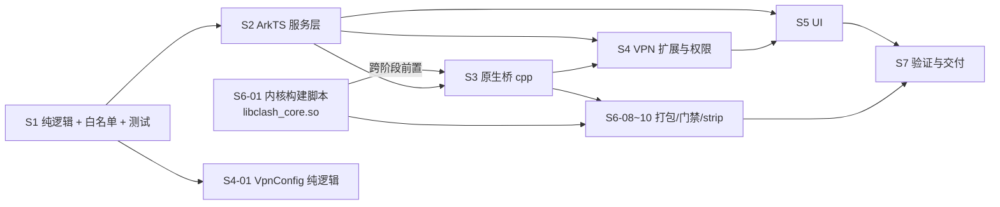

# HmChat 网络代理（mihomo 内核融合）实施任务清单

| 项目 | 内容 |
| --- | --- |
| 特性目录 | `.codeartsdoer/specs/clash-proxy-integration/` |
| 版本 | v1（2026-11-05） |
| 输入 | `docs/integration/clash-proxy-spec.md`（132 条 EARS）、`docs/integration/clash-proxy-design.md`（1729 行设计）、`harlgram-baseline.md`、`flclash-core-lib-baseline.md` |
| 任务总数 | **82 个任务**（S1 18 / S2 18 / S3 11 / S4 8 / S5 7 / S6 10 / S7 10） |
| 工时合计 | 约 **218.5 人时**（不含真机等待与用户授权等待） |
| 文档性质 | 只描述实施任务；不含源码、不含凭据、不修改签名与构建配置 |
| 交付证据分层 | 源码 / 编译 / 设备启动 / 真实服务端，四类分别记录，互不替代 |

> 本清单不改变设计结论。设计与本清单冲突时以设计为准，并在实施记录中登记偏差。

---

## 0. 如何使用本清单

1. 每个任务由一个 coding-engineer 独占，**文件属主唯一**；任务卡中的「文件」即该任务的写入边界，越界修改视为违规。
2. 同一文件出现两次时，后一任务必须在 `前置` 中写明 `blocked_by`，**不得并行**。
3. 每个任务完成时必须提交三样东西：改动文件、验收命令输出、`artifacts/clash-evidence/<task-id>/` 下的证据（日志/截图/readelf 输出）。`artifacts/` 已被忽略，不进入 Git。
4. 任务状态：`todo` → `doing` → `done`。只有「验收」全部通过才可标记 `done`；部分通过写 `done(partial)` 并在 S7 复核。
5. 禁止把「编译通过」写成「设备通过」，禁止把「模拟器通过」写成「真机通过」。

---

## 1. 全局约定

### 1.1 统一验证入口

| 编号 | 命令 | 用途 |
| --- | --- | --- |
| V0 | 见 §1.4 单文件转译 | 单个 `.ts` 文件的类型诊断 |
| V1 | `bash scripts/test-domain.sh` | 转译白名单 + 全部 `tests/*.test.mjs` |
| V2 | `bash scripts/build.sh debug` / `release` | SDK 26 真实 ArkTS + Native 编译；产物在 `entry/build/default/outputs/default/` |
| V3 | `python scripts/ci/verify-hap.py --hap <hap> --native-sdk <sdk>/native` | HAP 结构、双库、SONAME/NEEDED/RUNPATH、许可 |
| V4 | `HDC_TARGET=<sn> bash scripts/install.sh` → `bash scripts/run.sh` → `bash scripts/screenshot.sh` | 设备安装/启动/截图（必须显式指定设备） |
| V5 | `HDC_TARGET=<sn> hdc shell ...` | 设备侧检查：进程、端口、`ifconfig vpn-tun`、`getprop` |
| V6 | `llvm-readelf -d <so>` / `llvm-nm -D <so>` | 原生库元数据与导出符号 |

> Windows 工作副本的 `tests/`、`scripts/` 为 Git Bash 语义；PowerShell 中请通过 Git Bash 执行，或使用 `bash -lc`。

### 1.2 设备与证据纪律

- 本轮优先未展开的手机形态；用户已授权真机拔除后使用手机模拟器，但**模拟器为 x86_64，不含 `arm64-v8a` 内核**，只能验证 UI 与 ArkTS 逻辑，不得用于内核/ TUN 结论。
- 多设备在线必须 `HDC_TARGET` 指定；不得使用「首个设备」。
- 设备证据目录：`artifacts/clash-evidence/<task-id>/`，含 `command.txt`、`stdout.txt`、`screenshot.png`（去敏后）。
- 截图若含真实联系人/消息，仅存 `artifacts/`，不上传、不进入公开树。

### 1.3 敏感数据红线（每个任务自检）

- 订阅 URL、节点密码、UUID、token、验证码、会话文件内容：不得写入 Preferences、日志、通知、截图、测试夹具、Git 暂存区。
- 测试夹具一律使用虚构域名 `example.invalid`、虚构节点名 `node-a`、虚构 UUID 全零。
- 诊断导出必须先经 `ClashRedaction`；节点名哈希化，URL 截断为域名级摘要。

### 1.4 单文件转译（V0）

```bash
# 在 Git Bash 中，已 source scripts/env.sh
TS="${HARLGRAM_TYPESCRIPT:-$DEVECO_HOME/tools/ohpm/node_modules/typescript/lib/typescript.js}"
node -e "const t=require(process.argv[1]),f=require('fs');const p=process.argv[2];const r=t.transpileModule(f.readFileSync(p,'utf8'),{reportDiagnostics:true,compilerOptions:{target:t.ScriptTarget.ES2020,module:t.ModuleKind.CommonJS,strict:true}});const e=(r.diagnostics||[]).filter(d=>d.category===1);if(e.length){console.error(t.formatDiagnostics(e));process.exit(1)}console.log('OK '+p)" "$TS" entry/src/main/ets/model/ClashModels.ts
```

---

## 2. 文件命名对齐（实施期决定）

设计 §4.1 的模块名与本清单存在少量差异。为避免同一职责出现两个文件，实施期采用下表**唯一命名**，design.md §4.1 由文档维护者在 S1 完成后同步（本清单任务不改 design.md）。

| 本清单文件 | 对应设计条目 | 说明 |
| --- | --- | --- |
| `model/ClashModels.ts` | 同名 | 纯类型/常量 |
| `model/ClashError.ts` | 设计中的「错误枚举」 | 独立抽出，便于 UI 文案与分类共用 |
| `model/ClashStateMachine.ts` | 同名 | 六态 reducer |
| `model/ClashProfileRules.ts` | 同名 | profile 校验/命名/selectedMap/hash 判定 |
| `model/ClashRedaction.ts` | 同名 | 统一脱敏 |
| `model/ClashActionFactory.ts` | 设计未单列（散在 §9） | Action 信封、方法白名单、超时表、结果解码 |
| `model/ClashSubscriptionParser.ts` | `ClashProfileRules` 的 URL/内容校验 | 独立承担订阅正文/响应头/编码/体积策略 |
| `model/ClashGroupDeriver.ts` | **`ClashProxyCatalog.ts`（替代）** | 组派生、叶子解析、可用性 |
| `model/ClashDelayMap.ts` | `ClashModels` 内的 `DelayMap` | 独立成模块，含批量调度计划 |
| `model/ClashConfigPatch.ts` | 同名 | `RawConfig` patch |
| `model/ClashVpnConfig.ts` | §7.3 的「构造规则可测」 | 独立纯逻辑，S4 交付 |
| `services/clash/ClashRpcProtocol.ts` | 同名 | 字节级分帧纯实现 |

> **不做**：不新建 `ClashProxyCatalog.ts`、不在 `ClashModels.ts` 内实现 DelayMap 容器。

---

## 3. 任务依赖图

### 3.1 阶段级（含跨阶段前置）



### 3.2 关键串行链（不可并行）

```text
ClashModels ─┬─> ClashError ─> ClashStateMachine ─> ClashService(核心) ─> ProxyPage(容器) ─> ProxyPage(配置段) ─> ProxyPage(节点段) ─> Index 挂载 ─> 设备验收
             ├─> ClashActionFactory ─> ClashConfigBuilder
             ├─> ClashGroupDeriver ─> ProxyPage(节点段)
             └─> ClashRpcProtocol.ts ─> ClashRpcProtocol.ets ─┬─> ClashRpcServer(核心) ─> ClashRpcServer(限制/推送) ─> getConfig 白名单
                                                               └─> ClashRpcClient ─> ClashService(核心)

build-clash-core.sh ─> libclash_core.so ─> 桥链接 ─> DT_NEEDED 校验 ─> HAP 门禁 ─> 设备加载

单文件串行链（同一文件两次写入，必须 blocked_by）：
  ClashRpcServer.ets: S2-12 → S2-13 → S3-11
  ClashService.ets:   S2-16 → S2-17
  ClashVpnSession.ets:S4-05 → S4-06 → S4-07
  ProxyPage.ets:      S5-02 → S5-03 → S5-04 → S5-06
  Index.ets:          S5-05 → S5-07
  clash_bridge.cpp:   S3-01 → S3-02 → S3-03 → {S3-04, S3-05} → S3-06
  tests/transpile.mjs:S1-12 → S4-01（追加 1 条）
```

### 3.3 可并行组

| 并行组 | 任务 | 条件 |
| --- | --- | --- |
| P-A | S1-01 → {S1-02, S1-04, S1-05} | 均为纯逻辑，文件互不相同 |
| P-B | {S1-06, S1-08, S1-09, S1-10, S1-11} | 依赖 S1-01/02 完成后同时开工 |
| P-C | S1-13 ~ S1-17 | 全部依赖 S1-12，五组测试文件互不相同 |
| P-D | {S2-05, S2-10, S2-11, S2-15, S2-18} | 与 RPC 链无文件交集 |
| P-E | {S2-03→S2-04} 与 RPC 链 | 契约文件独立 |
| P-F | S6-02 / S6-03 / S6-08 / S6-09 | 许可、门禁、geo、忽略规则互不冲突；S6-01 完成前可先写夹具 |
| P-G | S5-01 与 S5-02 前半 | 组件先定签名，页面只引用不修改组件 |

---

## 4. P0 阻断项（未关闭不得宣称完成）

| 编号 | 阻断项 | 为什么阻断 | 关闭方式（可执行） | 失败处置 |
| --- | --- | --- | --- | --- |
| **P0-1** | GPL 对应源码不齐 | mihomo/sing-tun 为 GPL-3.0；无对应源码不得分发含内核 HAP | 执行 `scripts/package-clash-source.sh` 产出源码包；在**干净目录**用 `scripts/build-clash-core.sh` 重建同 ABI 库；比对 SONAME/NEEDED/SHA-256 与启动结果 | 停止分发；S1–S6 产物标「本机调试，不可分发」 |
| **P0-2** | 真机不可用 | 模拟器 x86_64 无 `arm64-v8a` 内核，TUN/授权/protect 无法验证 | `hdc list targets`；`hdc shell getprop ro.product.cpu.abi` 含 `arm64-v8a`；`HDC_TARGET` 显式指定 | 仅记录设计/编译证据，S3 之后任务全部 `blocked`，不得闭环 |
| **P0-3** | 用户订阅未授权 | 真实订阅含用户凭据；agent 不得代填 | 由用户自行在测试设备输入；agent 只用 `example.invalid` 虚构配置做导入链路验证；真实链路在 S7-06 由用户操作、agent 观察 | 只验证虚构配置，REQ-027/029/031 标「未验证」 |
| **P0-4** | SDK/NDK/Go 版本不符 | 内核必须用 OHOS Go 工具链 + 固定 NDK 交叉编译 | `cat local.properties`/`build-profile.json5` 核对 SDK `26.0.0.105`；`$DEVECO_HOME/sdk/default/openharmony/native` 存在；`go version` 与 `manifest.json` 记录一致 | 冻结构建，先修工具链，不产出「半成品 HAP」 |
| **P0-5** | HAP 未打包 `DT_NEEDED` 库 | `libclash_core.so` 未入包 → 扩展启动即 `core_missing`；Go initial-exec TLS 要求 `DT_NEEDED` 而非运行时 `dlopen` | 构建后 `unzip -l <hap> \| grep libclash` 必须有两个库；`llvm-readelf -d libclash_bridge.so \| grep NEEDED` 必须含 `libclash_core.so` | 若 hvigor 不打，改为显式打包步骤并同步 `verify-hap.py` 白名单 |
| **P0-6** | `llvm-strip` 破坏 Go `.so` | release 默认 `strip: true`，可能破坏 pclntab/异常信息导致启动崩溃 | release 构建 → 安装 → 启动 → `getCoreVersion` 可读 → 连续 3 次启停；`llvm-readelf -s` 与 strip 前比对 | release 关闭 strip 或按库排除内核；记录到 `docs/LICENSING.md` 与构建指纹 |

**P0 复核节奏**：S3 出口复核 P0-4/P0-5；S6 出口复核 P0-1/P0-6；S7-09 全量复核。任一 P0 未关闭 → 交付结论只能写「本机调试」。

---

## 5. Sprint 1（建议的前 8 个开发任务）

选择原则：全部为纯 `.ts`、无 Kit 依赖、可在宿主机验证，且不阻塞后续并行。

| 顺序 | 任务 | 工时 | 产出 | 为什么排在这里 |
| --- | --- | --- | --- | --- |
| 1 | **T-S1-01** ClashModels 类型与信封 | 1.5 h | `model/ClashModels.ts` | 所有模块的类型根 |
| 2 | **T-S1-02** ClashError 错误码与文案 | 1.5 h | `model/ClashError.ts` | 状态机、UI、诊断共用 |
| 3 | **T-S1-03** ClashStateMachine 六态 reducer | 3 h | `model/ClashStateMachine.ts` | 唯一真值，UI 不能越权写状态 |
| 4 | **T-S1-05** ClashRedaction 统一脱敏 | 1.5 h | `model/ClashRedaction.ts` | 后续所有日志/诊断/错误摘要的前置 |
| 5 | **T-S1-04** ClashProfileRules 校验与合并 | 2 h | `model/ClashProfileRules.ts` | 存储层与 UI 导入共用 |
| 6 | **T-S1-06** ClashActionFactory 信封与超时表 | 3 h | `model/ClashActionFactory.ts` | RPC/Action 两侧的唯一构造点 |
| 7 | **T-S1-10** ClashConfigPatch 白名单 patch | 3 h | `model/ClashConfigPatch.ts` | `rule` 键风险的唯一防线 |
| 8 | **T-S1-11** ClashRpcProtocol.ts 字节级分帧 | 2.5 h | `services/clash/ClashRpcProtocol.ts` | 双端通信基础，后续 .ets 只做薄封装 |

合计 18 h ≈ 2.5 人日。Sprint 1 出口：8 个文件 V0 全部 OK + T-S1-12 白名单加入后可 `node tests/transpile.mjs` 通过。

---

## 6. S1 · 协议与纯逻辑

> 阶段目标：所有可在宿主机验证的协议、状态、校验、patch、脱敏逻辑先落地，并进入 `tests/` 门禁。
> 全阶段禁止 import 任何 `@kit.*`、`@ohos.*`；只允许相对 import 的 `.ts` 模块。

### T-S1-01 · 定义 Clash 领域模型与 RPC 信封类型

- **目标**：给出双端共用的唯一类型根，覆盖六态、profile、节点、组、延迟、运行快照、Action 信封。
- **文件**：`entry/src/main/ets/model/ClashModels.ts`（新建，唯一属主）
- **前置**：无 ｜ **工时**：1.5 h
- **实现要点**：
  - 按设计 §8.2 定义 `ProxyProfile`、`ProxySettings`、`ProxyNode`、`ProxyGroup`、`DelayEntry`/`DelayMap`、`ProxyRuntimeSnapshot`、`ProxyError`；`state` 用字符串字面量联合，不用 enum（ArkTS 兼容）。
  - 定义 `ClashState = 'unconfigured'|'unauthorized'|'preparing'|'connected'|'stopped'|'failed'`，`ProxyScope = 'global'|'harlgramOnly'`。
  - 定义 RPC 信封 `RpcRequest`/`RpcResponse`/`RpcPush`、`ActionResult`（含 `code`）、`SetupParams`、`VpnOptions`。
  - 所有可选字段显式 `?:`，不使用 `any`/`unknown`/索引签名；JSON 边界用 `Record<string, string>` 收敛。
  - 常量：`RPC_PROTO = 1`、`RPC_MAX_FRAME_BYTES = 1048576`、`PROFILE_ID_PATTERN` 来源字符串常量。
- **验收**：V0 `model/ClashModels.ts` → `OK`；`grep -E "from '@(kit|ohos)"` 命中 0。
- **风险**：把 Dart 的 `dynamic` 结构照搬成 `any`，会导致后续 ArkTS 编译失败。

### T-S1-02 · ClashError 错误码、用户文案与分类

- **目标**：把设计 §7.9 的 18 个错误码变成单一映射，保证 UI 文案、重试建议、状态归类一致。
- **文件**：`entry/src/main/ets/model/ClashError.ts`（新建，唯一属主）
- **前置**：T-S1-01 ｜ **工时**：1.5 h
- **实现要点**：
  - 导出 `ProxyErrorCode` 联合类型，取值严格等于设计 §7.9 列表；`classify(code)` 返回 `'config'|'core'|'tun'|'rpc'|'protect'|'system'`。
  - `describe(code)` 返回 `{title, detail, nextAction, retryable}`；文案与设计 §11.5 逐字一致。
  - 明确 `core_missing` 不可重试且**不得**映射为授权类；`config_invalid` 不得映射为未授权。
  - `unknown` 只作最后兜底，禁止长期停留。
- **验收**：V0 → `OK`；`node --test tests/clash/error.test.mjs`（T-S1-13 交付）覆盖 18 个码各 1 条。
- **风险**：文案中出现 Action 名、SDK/ABI、路径；需按设计 §11.5「禁止」清单自查。

### T-S1-03 · ClashStateMachine 六态 reducer 与守卫

- **目标**：实现唯一状态真值；非法迁移被拒绝并计数，任何 UI 不得直接写状态。
- **文件**：`entry/src/main/ets/model/ClashStateMachine.ts`（新建，唯一属主）
- **前置**：T-S1-01、T-S1-02 ｜ **工时**：3 h
- **实现要点**：
  - 输入 `{state, epoch, event, facts}`，输出 `{state, epoch, changed, rejected?, record}`；`event` 覆盖设计 §3.3 迁移表全部行。
  - 证据聚合：`evidence = {coreReady, tunReady, routeReady}`，三者全真且同一 `epoch` 才允许 `preparing → connected`；单点 `init ok`/`port ok` 一律不迁移。
  - `preparing` 60 s 超时 → `failed(timeout)`；`linkLost` 时 `connected → preparing(reason=reconnect)`，重连预算 5 次（1/2/4/8/16 s），耗尽 → `failed(extension_crashed)`。
  - 旧 `epoch` 事件返回 `rejected{code:'stale_epoch'}`；非法迁移计数 `illegalTransitions`。
  - `preparing` 细分 `reason: 'start'|'apply'|'scope'|'reconnect'`，但不新增顶层状态（UI 文案需要）。
  - 纯函数、无副作用、不 Date.now()（时间由调用方注入）。
- **验收**：V0 → `OK`；`tests/clash/state-machine.test.mjs` 覆盖迁移表 13 行 + 6 条非法迁移 + epoch 丢弃 + 超时。
- **风险**：把 `unauthorized` 与 `failed` 合并；把「RPC 可达」当证据，会造成伪造 Ready。

### T-S1-04 · ClashProfileRules 校验、命名、selectedMap 与 hash 判定

- **目标**：提供 profile 合法性、显示名清洗、同内容判定、`selectedMap` 合并的纯逻辑。
- **文件**：`entry/src/main/ets/model/ClashProfileRules.ts`（新建，唯一属主）
- **前置**：T-S1-01 ｜ **工时**：2 h
- **实现要点**：
  - `isValidProfileId`：`^[A-Za-z0-9_-]{1,64}$`；拒绝 `.`/`..`/`/`/`\`/NUL/绝对路径/URL 编码绕过。
  - `sanitizeDisplayName`：去控制字符、trim、截断 64 字符；空值回退 `未命名配置`；重名追加 ` (2)`。
  - `mergeSelectedMap(current, next)`：仅保留存在的组名；空节点名丢弃（禁止 `changeProxy` 发送空串）。
  - `isSameContent(prevHash, nextHash)`：等价判定，供「无变化」提示；hash 计算不在本模块（由调用方传入）。
  - `buildProfileFileName(id)` → `<id>.yaml`，`buildPrevFileName(id)` → `<id>.prev.yaml`。
- **验收**：V0 → `OK`；`tests/clash/profile-rules.test.mjs` 覆盖 12 个非法 id、6 个命名边界。
- **风险**：`profileId` 从 URL/域名派生时带入 `:`/`?`；必须在生成处清洗。

### T-S1-05 · ClashRedaction 统一脱敏

- **目标**：所有日志、诊断、错误摘要、公开素材共用一套脱敏，避免各写一套。
- **文件**：`entry/src/main/ets/model/ClashRedaction.ts`（新建，唯一属主）
- **前置**：无 ｜ **工时**：1.5 h
- **实现要点**：
  - `redactUrl`：只保留 scheme + 主机名（可保留端口），删除 userinfo、path 中的 token、全部 query/fragment。
  - `redactHost`：保留最后一级域名或 `*.example.invalid` 风格；IP 只保留前两段。
  - `hashName`：节点名/组名 → 稳定短哈希（如 `n-<8hex>`），同一输入稳定，不依赖随机盐。
  - `truncate(text, n)`：**先脱敏再截断**，禁止先截断导致半截 URL 泄漏。
  - `safeError(e)`：只输出 `{code, detailCode}`，绝不输出 `message` 原文或响应体。
- **验收**：V0 → `OK`；`tests/clash/redaction.test.mjs` 覆盖 10 条真实形态样例（虚构值）。
- **风险**：正则漏掉 `user:pass@` 或 `?token=`；需用测试样例锁定。

### T-S1-06 · ClashActionFactory 信封、方法白名单、超时表与结果解码

- **目标**：Action 的构造与解码只有一个入口，杜绝 `code` 漏检和 `rules` 键误用。
- **文件**：`entry/src/main/ets/model/ClashActionFactory.ts`（新建，唯一属主）
- **前置**：T-S1-01、T-S1-02 ｜ **工时**：3 h
- **实现要点**：
  - `buildAction(id, method, data)`：`id` 形如 `<method>#<epoch>-<seq>`；`changeProxy` 的 `data` 为 JSON 字符串 `{group-name, proxy-name}`，**空 `proxy-name` 直接抛错**。
  - `buildSetupConfig(profilePathOrId, setupParams)` 只组装载荷，不读文件；`buildAsyncTestDelay(name, url, timeout)`。
  - `METHOD_WHITELIST` 严格等于设计 §5.4 的 24 项；其余 `method_not_allowed`。
  - `TIMEOUT_MS` 表：`getProxies 15s`、`changeProxy 15s`、`getConfig 20s`、`validateConfig 30s`、`setupConfig 60s`、`asyncTestDelay timeout+2s` 等，全部集中。
  - `decodeActionResult(raw)`：必须同时判 `code===0` **且**（字符串类方法）`data === ''` 才算成功；`setupConfig`/`validateConfig`/`updateConfig` 的空串语义单列。
  - 事件包装：`method:"message"` 的 `{type,data}` 解出，未知 `type` 返回 `null` 由上层丢弃计数。
- **验收**：V0 → `OK`；`tests/clash/action-factory.test.mjs` 覆盖：非 0 code、错误字符串、事件包装、空节点名拒绝、24 项白名单。
- **风险**：把 `data` 当对象传（内核要求 JSON 字符串）；`setupConfig` 的 fallback 伪成功。

### T-S1-07 · ClashSubscriptionParser 订阅 URL、响应头、内容边界

- **目标**：把「能不能拉、拉多少、叫什么名、是不是合法 YAML 文本」变成可测纯逻辑。
- **文件**：`entry/src/main/ets/model/ClashSubscriptionParser.ts`（新建，唯一属主）
- **前置**：T-S1-01、T-S1-05 ｜ **工时**：2.5 h
- **实现要点**：
  - `validateUrl`：仅 `http/https`；长度 ≤2048；拒绝空白/控制字符/含账号密码的 userinfo（存在时提示「请移除 URL 中的账号信息」）；`http` 返回 `plaintextWarning=true`。
  - `parseResponseHeaders`：只读 `content-disposition`、`subscription-userinfo`、`profile-update-interval`；`flclashx-*` 忽略；`subscription-userinfo` 解析 `upload/download/total/expire`，非法值单项忽略。
  - `checkBody(bytes)`：≤8 MiB；去 BOM；NUL 或明显二进制 → `binary_rejected`；非 UTF-8 → `encoding_rejected`。
  - `deriveDisplayName(disposition, yamlHint, urlHost)`：依次回退，清洗交给 `ClashProfileRules`。
  - `looksLikeBase64Subscription(text)`：仅用于提示「暂不支持该订阅格式」，不做解码。
- **验收**：V0 → `OK`；`tests/clash/subscription.test.mjs` 覆盖 8 MiB 边界（8 MiB-1/8 MiB/8 MiB+1）、BOM、NUL、无 content-disposition。
- **风险**：把 HTML 登录页当 YAML 成功；体积判断用字符数而非字节数。

### T-S1-08 · ClashGroupDeriver 组派生、叶子解析与可用性

- **目标**：从 `getProxies` 原始 JSON 派生 UI 所需的组/节点树，且自动组只读。
- **文件**：`entry/src/main/ets/model/ClashGroupDeriver.ts`（新建，唯一属主）
- **前置**：T-S1-01、T-S1-02 ｜ **工时**：2.5 h
- **实现要点**：
  - `parseProxies(json)`：容错空对象/缺字段；`type` 缺失视为不可用节点，不伪造。
  - `deriveGroups`：`['GLOBAL'] + GLOBAL.all.filter(isGroup)`；`hidden===true` 默认跳过；`isAuto = type !== 'Selector'`。
  - `resolveToLeaf(name, depth≤16)`：沿 `now` 递归；超深或环 → 返回组名并标记 `truncated`。
  - `ProxyNode.id = groupName + '/' + name`；`protocolLabel = type.toUpperCase()`；`availability` 依据 `type`/`alive`/必要字段。
  - `unavailableReason` 必须脱敏、面向用户（如「该节点类型暂不支持」），不含服务器地址。
  - 输出按组内原顺序，**不在派生阶段排序**（排序在 UI 层，避免大列表重复计算）。
- **验收**：V0 → `OK`；`tests/clash/catalog.test.mjs` 覆盖嵌套 3 层、循环引用、`hidden` 组、同名节点跨组。
- **风险**：`GLOBAL.all` 里混入非组节点；把 `now` 当节点名直接展示。

### T-S1-09 · ClashDelayMap 延迟聚合与批量调度计划

- **目标**：延迟结果只存内存，去重、可清除、批量并发可测。
- **文件**：`entry/src/main/ets/model/ClashDelayMap.ts`（新建，唯一属主）
- **前置**：T-S1-01 ｜ **工时**：1.5 h
- **实现要点**：
  - 结构 `url → proxyName → {value, at, state}`；`value=-1` 失败、`0` 加载中、`>0` 毫秒。
  - `applyDelay(name, url, value, at)`：同 `url+name` 覆盖；乱序到达按 `at` 丢弃旧值。
  - `planBatch(names, concurrency=4)`：返回分批数组，`concurrency` 夹紧 4–8；`cancel()` 返回已得结果保留、未完成置 `idle`。
  - `clearProfile(names)`、`clearAll()`；只做数据，不发请求。
- **验收**：V0 → `OK`；`tests/clash/delay-map.test.mjs` 覆盖乱序、并发夹紧、取消保留。
- **风险**：把延迟写进 Preferences；`0` 被当作成功值展示。

### T-S1-10 · ClashConfigPatch 白名单 patch 与最小 DNS 注入

- **目标**：在保留 profile 全部未知字段的前提下，只改白名单键，并保证规则键是 `rule`。
- **文件**：`entry/src/main/ets/model/ClashConfigPatch.ts`（新建，唯一属主）
- **前置**：T-S1-01 ｜ **工时**：3 h
- **实现要点**：
  - 输入/输出均为「已解析的开放对象」，**不重新构造配置**；未在白名单内的键原样透传。
  - 按设计 §10.4 表设置：`mode/rule`、`log-level`、`allow-lan=false`、`bind-address`、五个端口 `0`、`external-controller=""`、`external-ui=""`、`secret=""`、`find-process-mode=off`、`geodata-loader`、`unified-delay`、`tcp-concurrent`、`keep-alive-interval`、`profile.store-selected=false`、`tun.{enable,stack=gvisor,mtu=1420,dns-hijack,auto-route=false,auto-detect-interface=false}`。
  - 规则键：若存在遗留 `rules` 且无 `rule` → 迁移为 `rule` 并删除 `rules`；两者都在 → 以 `rule` 为准并记录告警；**patch 后断言 `rule` 键存在**（若原配置有规则）。
  - 回环直连：在规则数组前插入 `IP-CIDR,127.0.0.0/8,DIRECT,no-resolve`（仅当 `rule` 为非空数组，去重）。
  - 最小 DNS 注入：仅当 `dns` 缺失或 `dns.enable !== true`；`nameserver:['system']`、`fallback:[]`、`fake-ip-range:198.18.0.1/16`；不改动已有 `dns`。
  - 保留 `proxies`/`proxy-groups`/`proxy-providers`/`rule-providers`/`hosts`/`sniffer`。
- **验收**：V0 → `OK`；`tests/clash/config-patch.test.mjs` 覆盖：未知字段保留、`rules`→`rule`、双键告警、DNS 不覆盖、`rule` 断言、回环规则去重。
- **风险**：`rule` 写成 `rules` 导致规则全丢（设计 §15 中风险项）。

### T-S1-11 · ClashRpcProtocol.ts 字节级 NDJSON 分帧

- **目标**：实现跨 TCP 块安全的分帧器/编码器，供 `.ets` 两侧薄封装。
- **文件**：`entry/src/main/ets/services/clash/ClashRpcProtocol.ts`（新建，唯一属主）
- **前置**：T-S1-01 ｜ **工时**：2.5 h
- **实现要点**：
  - `encodeFrame(obj)` → UTF-8 bytes + `0x0A`，单帧 ≤1 MiB，超限抛 `frame_too_large`。
  - `FrameDecoder.push(chunk)`：**按字节找 `0x0A`**，整行再 UTF-8 解码；禁止先解码整块（防跨块多字节损坏）。
  - 未成帧缓冲 >1 MiB → `buffer_overflow`；空行丢弃；JSON 解析失败 → `malformed_frame`（带行号计数，不带内容）。
  - 请求/响应/推送三种信封的形状校验函数；`push` 必须无 `id`。
  - 提供 `reset()` 供重连复用。
- **验收**：V0 → `OK`；`tests/clash/rpc-protocol.test.mjs` 覆盖：中文/emoji 跨块、1 MiB 边界、无换行大帧、半帧重入、超限。
- **风险**：用 `String.fromCharCode` 拼 UTF-8；跨块 emoji 截断导致后续全部乱码。

### T-S1-12 · 把 11 个纯 `.ts` 加入转译白名单

- **目标**：让新增纯逻辑进入 `scripts/test-domain.sh` 的既有门禁。
- **文件**：`tests/transpile.mjs`（修改，**唯一属主**，本阶段仅此一次写入）
- **前置**：T-S1-01 ~ T-S1-11 全部完成 ｜ **工时**：0.5 h
- **实现要点**：
  - `files` 数组追加（按依赖顺序）：`model/ClashModels.ts`、`model/ClashError.ts`、`model/ClashStateMachine.ts`、`model/ClashProfileRules.ts`、`model/ClashRedaction.ts`、`model/ClashActionFactory.ts`、`model/ClashSubscriptionParser.ts`、`model/ClashGroupDeriver.ts`、`model/ClashDelayMap.ts`、`model/ClashConfigPatch.ts`、`services/clash/ClashRpcProtocol.ts`。
  - 不改动既有条目、输出目录与编译选项。
  - S4 追加 `model/ClashVpnConfig.ts` 由 T-S4-01 负责（同一文件，串行）。
- **验收**：`bash scripts/test-domain.sh` → 转译阶段退出码 0，`artifacts/tests/js/` 下生成 11 个 `.js`。
- **风险**：白名单路径大小写/斜杠不一致；`services/clash/` 目录不存在时抛错。

### T-S1-13 · 状态机与错误码单元测试

- **目标**：锁定迁移表、非法迁移、epoch 丢弃、错误码分类与文案。
- **文件**：`tests/clash/state-machine.test.mjs`、`tests/clash/error.test.mjs`（新建）
- **前置**：T-S1-12 ｜ **工时**：3 h
- **实现要点**：覆盖设计 §3.3 迁移表 13 行；6 条非法迁移返回 `rejected`；`stale_epoch` 丢弃；60 s 超时；重连预算耗尽；18 个错误码 `classify/describe`；禁止文案含 `preparing`/ABI/路径。
- **验收**：`node --test tests/clash/state-machine.test.mjs tests/clash/error.test.mjs` 全绿；用例数 ≥30。
- **风险**：测试里直接构造内部状态绕过 reducer，导致守卫未被覆盖。

### T-S1-14 · profile 校验与脱敏单元测试

- **目标**：锁定 id 边界、命名清洗、selectedMap 合并、URL/节点名脱敏。
- **文件**：`tests/clash/profile-rules.test.mjs`、`tests/clash/redaction.test.mjs`（新建）
- **前置**：T-S1-12 ｜ **工时**：2 h
- **实现要点**：12 个非法 profileId（点、点点、斜杠、反斜杠、NUL、超长、空、中文、URL 编码、绝对路径、含冒号、含问号）；`sanitizeDisplayName` 控制字符与 64 字符边界；`selectedMap` 空值丢弃与不存在的组剔除；`redactUrl` 的 userinfo、query、fragment、超长 path 四类；`hashName` 稳定性（同输入两次一致）。
- **验收**：`node --test tests/clash/profile-rules.test.mjs tests/clash/redaction.test.mjs` 全绿；脱敏样例断言「输出中不出现原始 token/密码/uuid」。
- **风险**：夹具写入真实订阅形态；必须使用 `example.invalid` 与全零 UUID。

### T-S1-15 · Action 信封与配置 patch 单元测试

- **目标**：锁定 `code` 检查、空串语义、白名单、`rule` 键、未知字段保留、DNS 不覆盖。
- **文件**：`tests/clash/action-factory.test.mjs`、`tests/clash/config-patch.test.mjs`（新建）
- **前置**：T-S1-12 ｜ **工时**：3 h
- **实现要点**：24 项白名单逐项断言；`changeProxy` 空 `proxy-name` 抛错；`setupConfig`/`validateConfig`/`updateConfig` 的「空串=成功」与非空错误串；事件包装 `method:"message"` 解包；patch 用例覆盖未知字段透传、`rules`→`rule`、双键告警、已有 `dns` 不被覆盖、回环规则只插一次、`tun` 各字段值。
- **验收**：`node --test tests/clash/action-factory.test.mjs tests/clash/config-patch.test.mjs` 全绿；含「`code=0` 但 `data=''` 对 `getProxies` 视为失败」负例。
- **风险**：只测 happy path，漏掉 `setupConfig` fallback 伪成功。

### T-S1-16 · 订阅、组派生、延迟单元测试

- **目标**：锁定体积/编码边界、头部解析、嵌套与循环组、延迟乱序。
- **文件**：`tests/clash/subscription.test.mjs`、`tests/clash/catalog.test.mjs`、`tests/clash/delay-map.test.mjs`（新建）
- **前置**：T-S1-12 ｜ **工时**：3 h
- **实现要点**：订阅用例覆盖 http 警告、userinfo 拒绝、content-disposition 文件名、subscription-userinfo 非法值、BOM/NUL/二进制、base64 提示；组派生覆盖嵌套 3 层、循环、hidden、跨组同名、叶子超深；延迟覆盖乱序丢弃、并发夹紧 4/8、取消保留已得值。
- **验收**：`node --test tests/clash/subscription.test.mjs tests/clash/catalog.test.mjs tests/clash/delay-map.test.mjs` 全绿；8 MiB 三档边界。
- **风险**：生成 8 MiB 夹具时提交进 Git；应在测试内动态构造字符串。

### T-S1-17 · RPC 分帧单元测试

- **目标**：锁定跨块 UTF-8、1 MiB 上限、半帧、多帧粘包。
- **文件**：`tests/clash/rpc-protocol.test.mjs`（新建）
- **前置**：T-S1-12 ｜ **工时**：2 h
- **实现要点**：单块多帧、跨块半帧、emoji 被切成 2 字节/4 字节两段、1 MiB 恰好通过、1 MiB+1 失败、无换行大帧、空行忽略、`reset()` 后可复用。
- **验收**：`node --test tests/clash/rpc-protocol.test.mjs` 全绿；至少 1 条 emoji 被拆到两个 chunk 的用例。
- **风险**：Node Buffer 与 ArkTS `ArrayBuffer` 语义差异，测试只覆盖 `Uint8Array` 契约。

### T-S1-18 · S1 出口门禁与证据归档

- **目标**：确认纯逻辑阶段可交付，且没有把 Kit 依赖偷偷带进来。
- **文件**：`artifacts/clash-evidence/s1-gate/`（新增证据，不入 Git）；不修改源码
- **前置**：T-S1-13 ~ T-S1-17 ｜ **工时**：1 h
- **实现要点**：跑 V1；grep 纯 `.ts` 目录的 `@kit`/`@ohos` 命中；统计测试用例数与覆盖的需求组；把日志存入证据目录。
- **验收**：`bash scripts/test-domain.sh` 退出码 0；`grep -R "@kit\|@ohos" entry/src/main/ets/model/Clash*.ts entry/src/main/ets/services/clash/ClashRpcProtocol.ts` 无命中；`artifacts/clash-evidence/s1-gate/stdout.txt` 存在。
- **风险**：把 `test-domain.sh` 的旧用例失败误判为本阶段失败；需先确认基线绿。

### 阶段出口标准（S1）

- [ ] 11 个纯 `.ts` 模块全部存在且 V0 通过，无 `any`/`unknown`。
- [ ] `tests/transpile.mjs` 白名单齐全，`bash scripts/test-domain.sh` 退出码 0。
- [ ] 状态机迁移表 100% 有测试；非法迁移与 `stale_epoch` 均被拒绝。
- [ ] `ClashConfigPatch` 断言 `rule` 键、保留未知字段、DNS 不被覆盖。
- [ ] 分帧测试覆盖跨块 UTF-8 与 1 MiB 上限。
- [ ] 纯逻辑层无 Kit import；证据归档到 `artifacts/clash-evidence/s1-gate/`。

---

## 7. S2 · ArkTS 服务层

> 阶段目标：把 S1 的纯逻辑接成可运行的 ArkTS 服务：会话交接、RPC 双端、NAPI 封装、存储、拉取、配置生成、事件解码、诊断、保活。
> 全阶段禁止：UI 侧 import `libclash_bridge.so`；`services/clash/**` import `TelegramService`/`MediaNetworkMonitor`/任何 TelephonyKit。

### T-S2-01 · ClashRpcProtocol.ets 常量与分帧桥接

- **目标**：在 ArkTS 侧暴露帧常量、错误码与 `Uint8Array` 分帧封装。
- **文件**：`entry/src/main/ets/services/clash/ClashRpcProtocol.ets`（新建，唯一属主）
- **前置**：T-S1-11 ｜ **工时**：1.5 h
- **实现要点**：常量与 `.ts` 同源（`RPC_PROTO`/`RPC_MAX_FRAME_BYTES`）；`FrameDecoder` 包装 `ClashRpcProtocol.ts`，输入 `Uint8Array`；错误码 `frame_too_large`/`malformed_frame`/`buffer_overflow` 映射为 RPC 错误对象；不重复实现分帧。
- **验收**：`bash scripts/build.sh debug` 编译通过（S1 白名单已含 `.ts`）；`grep "ClashRpcProtocol.ts"` 存在 import。
- **风险**：`.ets` 与 `.ts` 同名同目录导致解析歧义；确认 ArkTS 允许同名跨扩展名。

### T-S2-02 · ClashSessionFiles.ets 会话文件原子读写

- **目标**：实现 `req-<nonce>.json` / `ack-<nonce>.json` 的 0600 原子读写、nonce 校验与过期清理。
- **文件**：`entry/src/main/ets/services/clash/ClashSessionFiles.ets`（新建，唯一属主）
- **前置**：T-S2-01 ｜ **工时**：3 h
- **实现要点**：
  - 目录 `<files>/proxy/session/`，目录 0700、文件 0600；写 `.tmp` → `rename` 原子替换；先删同名旧文件。
  - `readRequest(nonce)` 校验：文件名与 `nonce` 一致、`proto===1`、`issuedAt + ttlMs` 未过期、token 长度 64、hex 字符集。
  - `writeAck(nonce, {port,pid,bootId,ready,errorCode?})`；bind 失败写 `ready:false`。
  - `cleanup()`：删除全部 `req-*`/`ack-*` 与 `.tmp`；`cleanupStale(now)` 删除过期项。
  - 不读 Asset、不碰 Preferences；日志只记文件名类别，不记 token。
- **验收**：设备侧 `ls -l .../files/proxy/session` 权限为 `-rw-------`；单元可测部分（路径规则/nonce 校验）在 S2 出口跑通。
- **风险**：`fs.rename` 跨设备失败；权限设置 API 与 API 26 不一致。

### T-S2-03 · libclash_bridge 类型契约与本地依赖

- **目标**：先定 ArkTS 可见契约，cpp 按契约实现，避免 `any` 与运行期才发现的签名不符。
- **文件**：`entry/src/main/cpp/types/libclash_bridge/Index.d.ts`（新建）、`entry/src/main/cpp/types/libclash_bridge/oh-package.json5`（新建）、`entry/oh-package.json5`（修改，**本任务唯一属主**）
- **前置**：T-S1-01 ｜ **工时**：2 h
- **实现要点**：
  - `Index.d.ts` 严格按设计 §6.2：`initCoreAsync(homeDir): Promise<CoreInitResult>`、`quickStartAsync(init, params, state): Promise<string>`、`invokeAction(json): void`、`startTun(fd): boolean`、`stopTun(): void`、`getRunTime(): number`、`getAndroidVpnOptions(): string`、`setState(json): void`、`shutdownCore(): boolean`、`notifyProtected(fd): void`、`getProtectStats(): string`、`setEventSink(cb: (payload: string) => void): void`。
  - 定义 `CoreInitResult { initialized: boolean; isInit: boolean; version: string; errorCode?: string }`；不出现 `any`。
  - `oh-package.json5` 的 `name` 必须是 `libclash_bridge.so`。
  - `entry/oh-package.json5` 仅追加 `"libclash_bridge.so": "file:./src/main/cpp/types/libclash_bridge"`；**不改** `signingConfigs`/`abiFilters`/`bundleName`。
- **验收**：`bash scripts/build.sh debug` 类型解析通过；`git diff entry/oh-package.json5` 只有 1 行新增。
- **风险**：`name` 写成 `libclash_bridge` 导致 import 解析失败；`d.ts` 暴露 `Promise<any>`。

### T-S2-04 · ClashCoreBridge.ets NAPI 封装与超时

- **目标**：扩展侧唯一访问内核的入口，统一超时、错误映射与单次 `setEventSink`。
- **文件**：`entry/src/main/ets/services/clash/ClashCoreBridge.ets`（新建，唯一属主）
- **前置**：T-S2-03 ｜ **工时**：3 h
- **实现要点**：
  - `initCore(homeDir, timeoutMs=30000)` → 调 `initCoreAsync` 并超时兜底；false/异常 → `core_init_failed`。
  - `quickStart(setup, state, timeoutMs=120000)`：空串=成功，非空 → `config_invalid`；**禁止使用同步 `quickStartSync`**。
  - `action(method, data, timeout)`：`invokeAction(JSON.stringify(...))` + 按 `id` 等待回调；超时返回结构化错误。
  - `setEventSink` 只调用一次；重复调用先释放旧 TSFN（由 cpp 保证）。
  - 错误码映射：`core_load_failed`/`core_symbol_missing`/`core_init_failed`。
  - 不拼接路径、不读文件。
- **验收**：`bash scripts/build.sh debug` 通过；静态检查 `grep "quickStartSync"` 在 `ets/` 下命中 0。
- **风险**：Promise 永不 resolve（cpp 未回投）；必须所有路径都有超时。

### T-S2-05 · ClashProfileStore.ets Asset + Preferences + 沙箱文件

- **目标**：三类介质各存其责，删除与回滚不留残渣。
- **文件**：`entry/src/main/ets/services/clash/ClashProfileStore.ets`（新建，唯一属主）
- **前置**：T-S1-04 ｜ **工时**：4 h
- **实现要点**：
  - Asset 别名 `harlgram.proxy.v1`，secret JSON `{version:1,entries:{<id>:{url,headers?}}}`；写操作单队列串行（参考 `CredentialVault` 的 Promise 链）；超容量时退化为 `harlgram.proxy.v1.<id>`（记录降级）。
  - Preferences `harlgram_proxy_v1`：`schemaVersion/settings/profiles[]`（含 `selectedMap`）；**不含 URL/密码/UUID/token/端口**；`isActive` 全局唯一。
  - 沙箱：`<files>/profiles/<id>.yaml`、`<id>.prev.yaml`、`providers/<id>/`；原子替换 + 失败恢复旧文件；权限 0600。
  - 损坏 Preferences → 备份 `harlgram_proxy_v1.corrupt` 并回退空设置。
  - `removeProfile(id)` 按设计 §8.8 六步；任一步失败返回残留清单（不含路径）。
- **验收**：设备侧读 Preferences 全文 `grep -i "http\|uuid\|password"` 命中 0；删除后 `ls profiles/` 无该 id；S2 出口用虚构数据跑一次导入→删除。
- **风险**：Asset 单条容量上限（Q4）；`fsync` 在 API 26 的可用性。

### T-S2-06 · backup_config 排除代理目录

- **目标**：代理配置/日志/geo 不进入系统备份。
- **文件**：`entry/src/main/resources/base/profile/backup_config.json`（修改，唯一属主）
- **前置**：无 ｜ **工时**：0.5 h
- **实现要点**：追加 `profiles/`、`proxy/`、`logs/`、`GeoIP.dat`、`GeoSite.dat`、`geoip.metadb`、`ASN.mmdb`；保持 TDLib 现有条目不变。
- **验收**：JSON 可解析（`node -e "JSON.parse(...)"`）；`git diff` 仅新增条目。
- **风险**：误删现有 `telegram/` 排除项。

### T-S2-07 · ClashSubscriptionFetcher.ets 受控 HTTP 拉取

- **目标**：只做一次、限时、限体积、不落正文、不记录请求头。
- **文件**：`entry/src/main/ets/services/clash/ClashSubscriptionFetcher.ets`（新建，唯一属主）
- **前置**：T-S1-07、T-S2-05 ｜ **工时**：3.5 h
- **实现要点**：
  - `@kit.NetworkKit` 的 `http`；连接 15 s / 读取 60 s；自动跟随 ≤5 次且仅 http/https；跨域重定向不携带认证头。
  - UA `HmChat/<versionName> (HarmonyOS; ClashProxy)`；**不发** `x-hwid` 等设备头。
  - 仅 2xx 成功；边收边计数，>8 MiB 立即 `destroy()` 并返回 `too_large`。
  - 正文写入调用方提供的临时文件句柄；fetcher 不持有全局引用，返回后不缓存。
  - 错误只返回域名级摘要 + 状态码；`ClashRedaction.redactUrl`。
  - 同一 profile 单飞、全局并发 ≤2。
- **验收**：用 `example.invalid` 虚构端点验证超时/超限/重定向；设备侧代理日志无完整 URL；`grep "x-hwid"` 命中 0。
- **风险**：`http` 模块流式读取 API 与预期不符，导致整包进内存。

### T-S2-08 · ClashConfigBuilder.ets getConfig → patch → SetupParams

- **目标**：把「读配置 → 白名单 patch → 组装 SetupParams」收敛为一个可回滚的步骤。
- **文件**：`entry/src/main/ets/services/clash/ClashConfigBuilder.ets`（新建，唯一属主）
- **前置**：T-S1-06、T-S1-10、T-S2-04 ｜ **工时**：3 h
- **实现要点**：
  - `getConfig(profileId)`：RPC `core.action`，`data` 只传 profileId（不传路径）；20 s 超时。
  - `build(profileId, selectedMap, testUrl, scope)`：`ClashConfigPatch.patch` → `SetupParams{config, 'selected-map', 'test-url'}`；`testUrl` 非法回退默认。
  - 保存最近一次成功快照 `{rawConfigJson, selectedMap, testUrl, scope, profileId}`（仅内存）；`rollback()` 重放。
  - patch 前 `JSON.parse` 失败 → `config_invalid`，不写任何文件。
- **验收**：`node --test tests/clash/config-patch.test.mjs` 仍绿；设备侧应用配置后 `getConfig` 复核 `rule` 键存在。
- **风险**：把整个 `RawConfig` 打日志；回滚快照写盘（含凭据）。

### T-S2-09 · ClashEventDecoder.ets 事件白名单与聚合

- **目标**：内核事件只以最小字段进入 UI，未知类型丢弃并计数。
- **文件**：`entry/src/main/ets/services/clash/ClashEventDecoder.ets`（新建，唯一属主）
- **前置**：T-S1-05、T-S1-08、T-S1-09 ｜ **工时**：2.5 h
- **实现要点**：
  - 白名单 `loaded|delay|traffic|log`；`delay{name,url,value}` 写入 `ClashDelayMap`（url 摘要化后再入 UI）；`traffic{up,down}` 1 Hz 聚合；`log{level,code}` 只保留 `error|warning` 分类码。
  - 不转发 `request`/连接明细/原始 JSON；未知 `type` → `droppedEvents++`。
  - `state`/`fault` 推送单独处理，不走本解码器。
- **验收**：`node --test tests/clash/delay-map.test.mjs` 仍绿；设备侧事件计数可见；日志无原始 JSON。
- **风险**：把 `log.data` 原文透传，泄漏域名。

### T-S2-10 · ClashAssetInstaller.ets geo 四件套首次部署

- **目标**：首启把 42.8 MB geo 数据分块复制到内核 home，并记录版本/哈希。
- **文件**：`entry/src/main/ets/services/clash/ClashAssetInstaller.ets`（新建，唯一属主）
- **前置**：T-S1-05 ｜ **工时**：2.5 h
- **实现要点**：
  - 检查 `<files>/{GeoIP.dat,GeoSite.dat,geoip.metadb,ASN.mmdb}`；缺失才复制，已存在且哈希一致则跳过。
  - rawfile 分块读取（≤1 MB/块），异步让出事件循环；总超时 90 s；进度回调「正在准备代理数据」。
  - 写 `<files>/proxy/geo.json`：`{version, sha256, size, copiedAt}`，不含绝对路径。
  - 失败 → `geo_missing`，不启动内核（禁止无 geo 假装规则可用）。
- **验收**：设备首启后 `ls -l files/` 四件套大小与源一致；`cat files/proxy/geo.json` 含 sha256；二次启动不重复复制。
- **风险**：42.8 MB 复制超时；rawfile 读取 API 限制单次大小。

### T-S2-11 · ClashDiagnostics.ets 状态环形缓冲与脱敏导出

- **目标**：可追溯状态迁移与计数，导出不含敏感信息。
- **文件**：`entry/src/main/ets/services/clash/ClashDiagnostics.ets`（新建，唯一属主）
- **前置**：T-S1-05 ｜ **工时**：2 h
- **实现要点**：
  - 环形缓冲 ≤256 条：`{at, from, to, event, errorCode, epoch}`；不做持久化。
  - 计数：`protect{attempts,failures,timeouts,dropped}`、`authTimeout/staleToken/frameTooLarge/rateLimited/illegalTransitions/droppedEvents`。
  - `export()`：经 `ClashRedaction` 脱敏，去掉路径/URL/IP/节点名原文（哈希化）。
- **验收**：导出 JSON 中 `grep -E "https?://|[0-9]{1,3}(\.[0-9]{1,3}){3}|/data/"` 命中 0。
- **风险**：缓冲写盘；导出包含订阅域名。

### T-S2-12 · ClashRpcServer.ets 监听、鉴权与会话轮换

- **目标**：扩展侧 RPC 入口：随机端口、首帧鉴权、ack 写回、重复握手轮换。
- **文件**：`entry/src/main/ets/services/clash/ClashRpcServer.ets`（新建，唯一属主）
- **前置**：T-S2-01、T-S2-02 ｜ **工时**：4 h
- **实现要点**：
  - `bind({address:'127.0.0.1', port:0, family:1})`；断言 `port !== 47471` 且 `1024–65535`；失败重试 3 次（100 ms 退避）→ ack `ready:false, errorCode:'rpc_bind_failed'`。
  - 首帧 5 s 内必须是 `auth{token,nonce,proto}`；常数时间比较（逐字节 XOR 累积，不短路）；失败 `auth_failed` 并断开、计数。
  - 成功返回 `{proto,sessionId,pid,bootId,serverTime}`；`sessionId` 16 hex，不含 token；成功后删除 req 文件。
  - `onConnect` 重复握手：向旧连接推 `fault{session_rotated}` → 关闭旧监听/旧连接 → 重新 bind → 写新 ack。
  - `getConfig` 分支先返回 `path_rejected` 占位，由 T-S3-11 接入真实路径解析。
  - 未鉴权连接：不处理任何方法、不发送任何 push。
- **验收**：设备侧 `netstat -anp | grep <pid>` 只看到随机端口，无 47471；错误 token 连接被拒并断开；连续两次会话端口不同。
- **风险**：`@kit.NetworkKit` 的 TCPSocket `bind` 入参形状；`onConnect` 与 `onCreate` 时序竞争。

### T-S2-13 · ClashRpcServer.ets 帧/连接/速率限制与推送通道

- **目标**：把暴露面压到最小，并在异常时快速断开。
- **文件**：`entry/src/main/ets/services/clash/ClashRpcServer.ets`（修改，**串行于 T-S2-12**）
- **前置**：T-S2-12 ｜ **工时**：3 h
- **实现要点**：
  - 单帧 ≤1 MiB、未成帧缓冲 ≤1 MiB → 断开并计数；连接数 ≤4（超限拒绝不排队）。
  - 每连接 50 req/s 突发 100、全局 200 req/s → `rate_limited`，连续 3 次断开；空闲 30 s 关闭；pending ≤256/客户端、≤512/服务端。
  - `push{state|event|fault}` 仅发已鉴权连接；推送字段白名单（不含路径/URL/token/域名）。
  - 关闭时先推 `state{stopped}` 再 `destroy()`；所有 socket 追踪到集合，`shutdown()` 全关。
- **验收**：脚本压 1 MiB+1 帧 → 连接被断；6 条并发连接第 5 条被拒；空闲 30 s 自动关闭。
- **风险**：速率限制误伤 1 Hz traffic 推送；推送与请求共用队列导致阻塞。

### T-S2-14 · ClashRpcClient.ets 连接、鉴权、请求关联与重连

- **目标**：UI 侧唯一 RPC 客户端，超时、断线、退避、单飞可预期。
- **文件**：`entry/src/main/ets/services/clash/ClashRpcClient.ets`（新建，唯一属主）
- **前置**：T-S2-01、T-S2-02 ｜ **工时**：4 h
- **实现要点**：
  - `connect(port, token, nonce)`：连 `127.0.0.1:<port>` → 5 s 内 `auth` → `hello`。
  - ack 轮询：250 ms × 40（10 s）；读不到 → `rpc_unavailable`；校验 `pid/bootId` 与 ack 一致。
  - 请求表 `Map<id, {resolve, reject, timer}>`；超时 reject 并移除，迟到响应按 id 丢弃；pending ≤256。
  - 重连退避 `1,2,4,8,16 s`，最多 5 次；稳定 60 s 清零；`session_rotated` 不重连。
  - 事件回调：`onPush(kind, data)`、`onState`、`onFault`、`onDisconnected(reason)`。
  - 不持有 token 到全局单例；断开即清空。
- **验收**：设备侧杀扩展 → 客户端 5 次退避后 `extension_crashed`；扩展重启 → 新端口新 token 重建成功；迟到响应不污染新请求。
- **风险**：`setTimeout` 在 UI 冻结时不准；重连与用户手动重试重复触发。

### T-S2-15 · ClashKeepAlive.ets dataTransfer 与 60 s 实况窗

- **目标**：只在 `connected` 后申请长时任务，停止即释放，避免被系统回收。
- **文件**：`entry/src/main/ets/services/clash/ClashKeepAlive.ets`（新建，唯一属主）
- **前置**：无（需 T-S2-16 调用） ｜ **工时**：3 h
- **实现要点**：
  - `enable(context: UIAbilityContext)`：`wantAgent`（`START_ABILITY`/`UPDATE_PRESENT_FLAG`，目标 `EntryAbility`）→ `startBackgroundRunning(context, ['dataTransfer'], agent)`。
  - 每 60 s 发布 `SYSTEM_LIVE_VIEW` + `SlotType.LIVE_VIEW` + `downloadTemplate` 进度（真实流量）；停止时取消定时器并 `stopBackgroundRunning`。
  - `disable()` 幂等；失败只告警并计数，不影响代理。
  - 监听 `continuousTaskStateChange`（若 API 26 提供）：被取消时回调 `onRevoked()` 给 `ClashService`。
- **验收**：设备锁屏 ≥10 分钟代理仍在（或被回收并如实上报）；停止后通知栏无残留。
- **风险**：扩展调用返回 401（本任务只在 UI 进程调用）；实况窗模板字段与 API 26 不符。

### T-S2-16 · ClashService.ets 核心：状态接线与启停单飞

- **目标**：UI 唯一门面，把 RPC/桥/状态机/保活接成一条可验收的启停链。
- **文件**：`entry/src/main/ets/services/clash/ClashService.ets`（新建，唯一属主）
- **前置**：T-S2-04、T-S2-09、T-S2-13、T-S2-14、T-S2-15 ｜ **工时**：4 h
- **实现要点**：
  - 持有 `ClashStateMachine` 真值；对外只暴露 `snapshot` 与订阅回调，禁止外部写状态。
  - `start()`：校验配置存在且 `nodeCount>0` → 生成 token/nonce → 写 req → `startVpnExtensionAbility(Want{clashSessionNonce, clashSessionFile})` → 轮询 ack → 连接 → `hello`（`coreLoaded=false` 直接 `failed(core_missing)`，不请求授权）→ `core.init` → `vpn.options` → `tun.start`。
  - `stop()`：`tun.stop` → 校验 `released` → `KeepAlive.disable` → `stopped`；有 warning → `stopped_with_warning`。
  - `startInFlight`/`stopInFlight` 单飞；重复点击合并为最后意图；每次启停 `epoch++`。
  - `linkLost` → `preparing(reconnect)`，预算耗尽 → `failed(extension_crashed)`。
  - 启动总预算 60 s。
- **验收**：设备上「配置缺失时点开关」→ 保持 `unconfigured` 且不拉起扩展；临时重命名内核库 → `failed(core_missing)` 且**不弹授权**。
- **风险**：在 `hello` 之前请求授权；把 ack 成功当 `connected`。

### T-S2-17 · ClashService.ets 数据操作：导入/应用/节点/测速

- **目标**：把订阅、配置应用、节点切换、测速、删除接到门面，并保证失败可回滚。
- **文件**：`entry/src/main/ets/services/clash/ClashService.ets`（修改，**串行于 T-S2-16**）
- **前置**：T-S2-16、T-S2-05、T-S2-07、T-S2-08、T-S2-11 ｜ **工时**：4 h
- **实现要点**：
  - `importSubscription(url)`：校验 → 拉取 → `validateConfig` → 原子写 + Asset + 元数据 → `getProxies` 统计 → `unconfigured→stopped`；不建 TUN、不弹授权。
  - `importLocalYaml(uri)`：系统选择器给的 uri 只读一次（≤8 MB）→ 同上；命名冲突追加序号。
  - `updateProfile(id)`：保留 `.prev`；失败保留旧配置与最后成功时间；不自动 apply。
  - `applyProfile(id)`：`preparing(apply)` → `getConfig→patch→setupConfig`；失败重放旧快照。
  - `selectNode(group, node)`：`changeProxy`；成功写 `selectedMap`，失败回滚标记。
  - `probeDelay(name)` / `probeAll()`（并发 4、可取消）/ `clearDelays()`。
  - `removeProfile(id)`：active 且在运行先停止；清 DelayMap。
  - `setScope(scope)`：`preparing(scope)` → `tun.stop` + `tun.start`；失败回滚旧 scope。
- **验收**：S7-06 用用户授权订阅验证节点/组数与实际一致；应用后 `getProxies.now` 与 UI 标记一致（连续 3 次）。
- **风险**：更新后自动 apply 造成意外断网；`changeProxy` 空节点名。

### T-S2-18 · MediaNetworkMonitor 物理网络探测修正

- **目标**：自有 VPN 生效后，不把 `BEARER_VPN` 判成蜂窝/漫游，避免自动下载被关。
- **文件**：`entry/src/main/ets/services/MediaNetworkMonitor.ets`（修改，**唯一属主**）、`tests/media-models.test.mjs`（追加用例）
- **前置**：无 ｜ **工时**：2.5 h
- **实现要点**：
  - 优先 `connection.getAllNets()`（若 API 26 提供）过滤 `BEARER_VPN`，按「WIFI → 非计量 → 蜂窝」选择。
  - 只有默认网络且为 `BEARER_VPN` → 沿用内存 `lastPhysicalNetwork` 并置 `viaVpn=true`；不得因 VPN 判 `roaming`。
  - `BEARER_VPN` 不参与 `isRoaming`；读取失败且无历史 → `mobile`（非 `roaming`）并记 `networkUnknown`。
  - 代理开关**不触发** `refresh()`；只有系统网络变化触发。
- **验收**：`node --test tests/media-models.test.mjs` 全绿；设备 Wi-Fi 下代理开启前后 `MediaNetwork` 均为 `wifi`。
- **风险**：`getAllNets` 不存在时的降级路径未覆盖；误改 TDLib `setNetworkType` 调用点。

### 阶段出口标准（S2）

- [ ] 13 个 `.ets` 服务文件 + 1 个类型契约 + 1 个备份配置全部落地，`bash scripts/build.sh debug` 退出码 0。
- [ ] 扩展侧无 `TelegramService`/`MediaNetworkMonitor`/TelephonyKit import（`grep` 命中 0）。
- [ ] 会话文件权限 0600、目录 0700，停止后目录为空。
- [ ] 错误 token 被拒、连续会话端口不同、47471 无监听。
- [ ] Preferences 全文检索无 URL/密码/UUID/token。
- [ ] `ClashService` 对外不暴露状态写入接口；`state` 只来自 reducer。
- [ ] 设备证据：`artifacts/clash-evidence/s2-*/`（编译日志、端口检查、Preferences 脱敏截图）。

> S2 的编译只证明 ArkTS 类型与打包结构；内核 `.so` 未就绪时的运行期加载验证放在 T-S3-10。

---

## 8. S3 · 原生层（NAPI 桥 / CMake / 内核产物）

> 阶段目标：`libclash_bridge.so` 按 T-S2-03 契约导出全部符号，以 `DT_NEEDED` 链接 `libclash_core.so`，并能在扩展进程加载成功。
> 全阶段禁止：在 `napi_init.cpp`（TDLib 桥）里加入任何 clash 逻辑；禁止给 UI 进程的 `libentry.so` 链接内核。
> **跨阶段前置**：T-S3-09 / T-S3-10 依赖 T-S6-01 产出的 `libclash_core.so`（设计的阶段划分把构建脚本放在 S6，实施顺序上必须先跑出内核）。

### T-S3-01 · clash_bridge.cpp 骨架、模块注册与符号解析

- **目标**：建立独立 NAPI 模块 `clash_bridge`，在不暴露路径的前提下加载内核并报出结构化失败。
- **文件**：`entry/src/main/cpp/clash/clash_bridge.cpp`（新建，唯一属主；本阶段 6 个任务串行写此文件）
- **前置**：T-S2-03 ｜ **工时**：3 h
- **实现要点**：
  - `napi_module` 注册 `nm_modname = "clash_bridge"`，`nm_version = 1`，`Init` 只注册设计 §6.2 的导出。
  - 解析方式：以链接期 `DT_NEEDED libclash_core.so` 作为「已加载锚点」，再 `dlopen("libclash_core.so", RTLD_NOW|RTLD_NOLOAD)` 取 handle + `dlsym` 取符号；**不得**首次运行期 `dlopen`（Go initial-exec TLS 限制，设计 §6.1）。
  - 失败分类：`dlopen` 失败 → `core_load_failed`；符号缺失 → `core_symbol_missing`（记录符号名，不记录路径）；`initClashSync` false → `core_init_failed`。
  - 日志：`libhilog_ndk.z.so`，字段白名单 `{模块, 级别, 错误码, 计数}`；不打印 home 路径、Action JSON。
  - 所有导出必须有 `napi_value` 入参校验；类型不符返回 `napi_throw_type_error`。
- **验收**：V2 编译通过且产出 `libclash_bridge.so`；V6 `llvm-nm -D libclash_bridge.so | grep napi` 可见 12 个导出符号；缺库时 `hello` 走 `core_missing`（T-S3-10 联调）。
- **风险**：`RTLD_NOLOAD` 在 OHOS musl 的行为与 glibc 不同；符号名与 Go `c-shared` 导出一致性需实机确认。

### T-S3-02 · 异步 init 与回调式 quickStart

- **目标**：初始化与大配置应用不阻塞扩展 ArkTS 线程，期间 protect 仍可回执。
- **文件**：`entry/src/main/cpp/clash/clash_bridge.cpp`（修改，**串行于 T-S3-01**）
- **前置**：T-S3-01 ｜ **工时**：3 h
- **实现要点**：
  - `initCoreAsync(homeDir)`：`napi_async_work` + `execute` 中调用 `initClashSync(29, homeDir)`；`complete` 回投 `{initialized,isInit,version,errorCode}`；`version` 由 `getCoreVersion` 取，取不到给 `''` 不编造。
  - `quickStartAsync(init, params, state)`：在 async work 线程调用**回调式** `quickStart(init, params, state)`；返回空串=成功，非空原样回投（由 ArkTS 映射 `config_invalid`）。
  - 禁止 `quickStartSync`（设计 §6.5）；`grep quickStartSync` 在 `cpp/clash/` 命中 0。
  - 同一时刻只允许 1 个 quickStart；重复调用返回 `busy`。
  - async work 线程内禁止触碰 JS 对象，全部通过 complete 回投。
- **验收**：设备侧大配置（≥5 MB YAML）应用期间扩展仍能响应 `diagnostics.snapshot`；`getRunTime` 调用不超时。
- **风险**：`napi_async_work` 与 TSFN 生命周期错配导致 use-after-free；`quickStart` 回调可能在 Go goroutine 中触发。

### T-S3-03 · 三路 TSFN：event / actionResult / protect

- **目标**：把上游单 TSFN（容量 4）拆成三路，protect 永不被 event/result 挤掉。
- **文件**：`entry/src/main/cpp/clash/clash_bridge.cpp`（修改，**串行于 T-S3-02**）
- **前置**：T-S3-02 ｜ **工时**：3.5 h
- **实现要点**：
  - event 容量 64、actionResult 容量 256、protect 容量 64；event/result 用 `napi_tsfn_nonblocking`，满则计数丢弃。
  - `setEventSink(cb)`：创建 3 个 TSFN 与 1 个 `ThreadSafeFunction` 引用；重复设置先 `napi_release_threadsafe_function(..., napi_tsfn_abort)` 释放旧值。
  - payload 一律 UTF-8 JSON 字符串（`napi_create_string_utf8`），**不传结构体指针**。
  - 投递顺序：先 protect，再 actionResult，最后 event（protect 优先级最高）。
  - 进程退出/`shutdownCore` 时释放全部 TSFN，避免 Go 回调写入已释放句柄。
- **验收**：设备侧 `eventDropped/resultDropped` 计数在 `getProtectStats` 或诊断中可见；protect 压测期间 event 洪泛不导致 protect 丢弃。
- **风险**：TSFN 回调线程与 Go goroutine 并发；释放时机早于 `stopTun()`。

### T-S3-04 · Action 调用、结果关联与上限

- **目标**：`invokeAction` fire-and-forget + 结果按 `id` 关联，迟到响应丢弃。
- **文件**：`entry/src/main/cpp/clash/clash_bridge.cpp`（修改，**串行于 T-S3-03**）
- **前置**：T-S3-03 ｜ **工时**：3 h
- **实现要点**：
  - `invokeAction(json)` 校验 JSON 有 `id`/`method`；直接调用内核 `action` 入口，不等待。
  - 结果经 `actionResult` TSFN 回投为 `ActionResult` 原样结构（含 `code`）。
  - 在途表 ≤256：登记 `id → 时间戳`；超过直接拒绝 `too_many_pending`。
  - 结果到达时若 `id` 不在在途表 → `lateResults++` 丢弃，不回调 JS。
  - 不解析、不重写 `data`（尤其 `SetupParams`）。
- **验收**：设备侧连续发起 300 个 Action → 第 257 个被拒；人为延迟响应 → 迟到计数 +1 且 JS 未收到。
- **风险**：在途表与 ArkTS 侧 pending 表双重超时不一致。

### T-S3-05 · protect 握手可靠性（阻塞重试 + 超时 + 代次键）

- **目标**：protect 有界、可观测、失败不静默；避免流量环路。
- **文件**：`entry/src/main/cpp/clash/clash_bridge.cpp`（修改，**串行于 T-S3-03**，可与 T-S3-04 并行）
- **前置**：T-S3-03 ｜ **工时**：3.5 h
- **实现要点**：
  - Go 侧 `TrampProtect` 回调 → 投递 `{type:"protect", data:{fd, epoch, gen}}` 到 protect TSFN；队列满 → `5 ms` 退避重试，总预算 `3000 ms`。
  - 等待 ack ≤3000 ms；超时 `timeouts++`，**仍调用 `notifyProtected(fd)`** 解除 Go 阻塞，避免永久卡死。
  - `fd <= 0` 直接拒绝并计数，不 ack 成功。
  - 键 = `fd + epoch + gen`；未知键 ack → `unknownFd++`；fd 复用不得错配。
  - `getProtectStats()` 返回 `{attempts,failures,timeouts,dropped,unknownFd,lastCode}`；`lastCode` 为枚举字符串，不含 fd 值。
  - 停止 TUN 前等待 pending protect 结算或 3 s 超时（与 T-S4-07 协同）。
- **验收**：50 并发建连 + 连续 10 分钟流量 → `failures=0,timeouts=0,dropped=0`；人为塞满 protect 队列 → 出现 `queue_full` 且代理降级而非静默放行。
- **风险**：Go 回调线程中阻塞重试导致 dialer 排队雪崩；3 s 预算与上游 1500 ms 语义冲突（需在设备上标定）。

### T-S3-06 · 同步短调用导出

- **目标**：补齐 fd 所有权、运行时长、TUN 参数、状态与关闭的同步导出。
- **文件**：`entry/src/main/cpp/clash/clash_bridge.cpp`（修改，**串行于 T-S3-04/S3-05**）
- **前置**：T-S3-04、T-S3-05 ｜ **工时**：2.5 h
- **实现要点**：
  - `startTun(fd)`：调用内核 `startTun`；返回 true 表示 fd 所有权已转移；失败时**不 close(fd)**（内核可能已关闭，设计 §7.3）。
  - `stopTun()`、`getRunTime()`（epoch ms，0=未启动）、`getAndroidVpnOptions()`、`getCurrentProfileName()`、`setState(json)`、`shutdownCore()`、`notifyProtected(fd)`。
  - 全部为短调用，禁止在其中做文件 IO 或等待 Go 长任务。
  - `shutdownCore()` 失败也返回 false 并记录 `shutdown_failed`，不抛异常。
- **验收**：V6 导出符号与 `Index.d.ts` 逐项比对无缺；设备上 `getRunTime()` 在未启动时返回 0，`startTun` 后 >0。
- **风险**：`startTun` 失败路径重复 close 造成 fd 复用误关。

### T-S3-07 · cpp/clash/CMakeLists.txt 目标定义

- **目标**：独立的 `clash_bridge` 构建片段，不污染 TDLib target。
- **文件**：`entry/src/main/cpp/clash/CMakeLists.txt`（新建，唯一属主）
- **前置**：T-S3-01 ｜ **工时**：1.5 h
- **实现要点**：
  - C++17、`-fno-exceptions`/`-fno-rtti` 与现有 target 保持一致（以现有 `cpp/CMakeLists.txt` 为准）；`add_library(clash_bridge SHARED clash_bridge.cpp)`。
  - `target_include_directories` 与 NAPI 头路径复用现有写法；链接 `libace_napi.z.so`、`libhilog_ndk.z.so`、`dl`。
  - 内核链接：`target_link_libraries(clash_bridge PRIVATE ${NATIVERENDER_ROOT_PATH}/../../../libs/${OHOS_ARCH}/libclash_core.so)`，生成 `DT_NEEDED`。
  - `set_target_properties(clash_bridge PROPERTIES OUTPUT_NAME clash_bridge PREFIX "lib" SUFFIX ".so")`；**不设** `BUILD_RPATH`/`INSTALL_RPATH`。
  - 若 `${OHOS_ARCH}` 未定义，用 `CMAKE_ANDROID_ARCH_ABI`/`OHOS_ARCH` 兜底并 `message(FATAL_ERROR)` 明确报错（Q7）。
- **验收**：`bash scripts/build.sh debug` 后 `llvm-readelf -d libclash_bridge.so` 含 `NEEDED libclash_core.so`，无 `RPATH/RUNPATH`。
- **风险**：`${NATIVERENDER_ROOT_PATH}` 相对层级与实际 `entry/libs` 不一致；`OHOS_ARCH` 变量名未定义。

### T-S3-08 · 合并进 cpp/CMakeLists.txt（双 target 共存）

- **目标**：一个 `externalNativeOptions.path` 同时构建 `entry` 与 `clash_bridge`。
- **文件**：`entry/src/main/cpp/CMakeLists.txt`（修改，**唯一属主，仅此一次写入；不得改动 TDLib 链接逻辑**）
- **前置**：T-S3-07 ｜ **工时**：1 h
- **实现要点**：
  - 在文件末尾 `add_subdirectory(clash)`；确认 `project`/`cmake_minimum_required` 不被重复定义。
  - 保持 `entry` target 的源文件、链接库、编译选项不变（`libentry.so` 不得新增内核依赖）。
  - 只追加 `clash` 子目录，不重排现有内容，降低与 TDLib 并行改动的冲突。
- **验收**：构建产物同时含 `libentry.so` 与 `libclash_bridge.so`；`llvm-readelf -d libentry.so | grep clash` 命中 0。
- **风险**：`add_subdirectory` 后 target 输出目录变化，导致 HAP 缺少桥库。

### T-S3-09 · 内核产物落位与 SONAME/NEEDED 预检

- **目标**：把 T-S6-01 产出的内核库放到工程约定位置，并在链接前确认元数据正确。
- **文件**：`entry/libs/arm64-v8a/libclash_core.so`（构建产物，**已忽略，不提交**）
- **前置**：**T-S6-01**（跨阶段）、T-S3-07 ｜ **工时**：1.5 h
- **实现要点**：
  - 从 `artifacts/clash-core/` 复制产物到 `entry/libs/arm64-v8a/`；校验 SHA-256 与 `manifest.json` 一致。
  - `llvm-readelf -d`：`SONAME == libclash_core.so`；`llvm-readelf -h`：`AArch64`、`DYN`。
  - `llvm-readelf -d` 不得出现绝对路径 `RUNPATH/RPATH`。
  - 记录 `go version -m` 输出到证据目录（脱敏，去除本机路径）。
- **验收**：`llvm-readelf -d entry/libs/arm64-v8a/libclash_core.so | grep SONAME` 输出恰为 `libclash_core.so`；SHA-256 与 manifest 一致。
- **风险**：内核构建未加 `-Wl,-soname`；复制错架构（x86_64 模拟器产物）。

### T-S3-10 · 桥编译、双库校验与扩展进程加载冒烟

- **目标**：证明「双 target 编译 + 双库入包 + 扩展能加载内核」这条链闭合。
- **文件**：无源码修改；证据写入 `artifacts/clash-evidence/s3-load/`
- **前置**：T-S3-06、T-S3-08、T-S3-09 ｜ **工时**：3 h
- **实现要点**：
  - `bash scripts/build.sh debug` → 0；`unzip -l <hap> | grep -E "libclash_(core|bridge)"` 两个都在 `libs/arm64-v8a/`。
  - `llvm-readelf -d libclash_bridge.so` 含 `NEEDED libclash_core.so`，且无 `RUNPATH`。
  - 设备安装启动 → 触发扩展 → RPC `hello` 返回 `coreLoaded:true`、`coreVersion` 等于固定版本、`capabilities.tun/protect/asyncStart` 均为 true。
  - **不建 TUN、不弹授权**：`hdc shell ifconfig` 无 `vpn-tun`。
  - 人为移走内核库重装 → `coreLoaded:false`、`failed(core_missing)`、无授权弹窗。
- **验收**：上述 5 条全部有证据文件（readelf 输出、HAP 清单、`hello` JSON、`ifconfig` 输出、失败态截图）。
- **风险**：hvigor 不打包「未被 NAPI 直接引用」的 `DT_NEEDED` 库（Q8）；strip 破坏内核（见 P0-6）。

### T-S3-11 · getConfig 路径白名单（ArkTS 侧强制）

- **目标**：UI 不能传路径；profileId 必须被规范化到 `<home>/profiles/` 内，杜绝任意读。
- **文件**：`entry/src/main/ets/services/clash/ClashProfilePaths.ets`（新建）、`entry/src/main/ets/services/clash/ClashRpcServer.ets`（修改，**串行于 T-S2-13**）
- **前置**：T-S2-13、T-S1-04 ｜ **工时**：2.5 h
- **实现要点**：
  - `resolveProfilePath(home, profileId)`：`isValidProfileId` → 拼 `<home>/profiles/<id>.yaml` → 规范化 → 断言 `startsWith(home + '/profiles/')`。
  - `realpath` 后**再次**校验前缀，防符号链接逃逸；不满足 → `path_rejected`，不调用内核。
  - provider 路径限定 `<home>/profiles/providers/<id>/`，同样双重校验。
  - RPC `core.action` 的 `getConfig` 只接受 `data = profileId`；收到绝对路径/含 `/` 的值 → `path_rejected`。
  - 内核 home 必须等于 ArkTS 配置根（`.../el2/base/files`），不一致直接 `internal`。
- **验收**：构造 `../`、绝对路径、符号链接、含 NUL 的 4 类输入 → 全部 `path_rejected` 且内核未被调用（计数 +1）；正常 id 可读到 `RawConfig`。
- **风险**：`realpath` 在文件不存在时抛错，需区分「不存在」与「越界」。

### 阶段出口标准（S3）

- [ ] `libclash_bridge.so` 12 个导出与 `Index.d.ts` 一一对应；`grep quickStartSync cpp/clash/` 命中 0。
- [ ] 三路 TSFN 独立，protect 优先，容量 64/256/64。
- [ ] `libclash_bridge.so` 的 `NEEDED` 含 `libclash_core.so`，两库 SONAME 正确，无 `RUNPATH`。
- [ ] HAP 的 `libs/arm64-v8a/` 同时含 `libentry.so`、`libtdjson.so`、`libc++_shared.so`、`libclash_bridge.so`、`libclash_core.so`。
- [ ] 设备上 `hello.coreLoaded=true`、`coreVersion` 等于固定版本，且**未建 TUN、未弹授权**。
- [ ] 缺库时 `core_missing`，无伪造 Ready。
- [ ] `getConfig` 4 类越界输入全部 `path_rejected`。

> 若 P0-5（HAP 不打包 DT_NEEDED）或 P0-6（strip 破坏）未关闭，S3 只能标 `done(partial)`。

---

## 9. S4 · VPN 扩展与权限

> 阶段目标：扩展进程承载 RPC + 桥 + TUN；首次授权、三重证据、protect 降级、停止收敛、范围切换、通知全部可验证。
> 全阶段禁止：扩展 import `contacts`/`geo`/`audio`/`camera`/`call`/`sim`/`sms`/`@kit.TelephonyKit`；禁止 import UI 侧模块。

### T-S4-01 · ClashVpnConfig.ts 纯构造与校验

- **目标**：把 `VpnOptions + scope + bundleName` 到 `VpnConfig` 的映射变成可测纯逻辑（REQ-017/077/078）。
- **文件**：`entry/src/main/ets/model/ClashVpnConfig.ts`（新建）、`tests/clash/vpn-config.test.mjs`（新建）、`tests/transpile.mjs`（追加 1 条，**串行于 T-S1-12**）
- **前置**：T-S1-12、T-S1-01 ｜ **工时**：3 h
- **实现要点**：
  - `addresses`：`172.19.0.1/30`，IPv6 开启时追加 `fdfe:dcba:9876::1/126`；`routes` 取 `routeAddress`，空则 `0.0.0.0/0`，IPv6 加 `::/0`。
  - `mtu=1420`（夹紧 576–1500）；`dnsAddresses=['172.19.0.2']`；`isIPv4Accepted=true`；`isIPv6Accepted` 只由地址决定。
  - `trustedApplications`：`harlgramOnly` → `[bundleName]`；`global` → `[]`；`blockedApplications` 恒 `[]`；构造后断言二者不同时非空。
  - `options` 缺字段/空串/非法地址 → 用设计默认值并返回 `fallbackCodes[]`；不得把 `undefined` 传入。
  - 忽略 `port`/`bypassDomain`/`accessControl`。
  - 非法地址/路由/IPv6 → 返回 `tun_config_invalid`，调用方不得 `create`。
- **验收**：`node --test tests/clash/vpn-config.test.mjs` 全绿（含 6 条非法输入、scope 互斥、IPv6 开关）；`bash scripts/test-domain.sh` 退出码 0。
- **风险**：`trustedApplications` 只填包名而系统要求完整 ability 名；`blockedApplications` 被误填导致其他应用断网。

### T-S4-02 · ClashVpnExtensionAbility.ets 扩展入口骨架

- **目标**：扩展生命周期与 handler 注册，保证「不加载内核也能先建 RPC」。
- **文件**：`entry/src/main/ets/vpn/ClashVpnExtensionAbility.ets`（新建，唯一属主）
- **前置**：T-S2-12、T-S2-02 ｜ **工时**：3 h
- **实现要点**：
  - `onCreate(want)`：计算 `homeDir`（`filesDir` 按 `/haps/` 截断 + `/files`，设计 §7.1）；创建 `ClashRpcServer`；注册 handler（`hello`/`core.*`/`tun.*`/`vpn.options`/`notification.update`/`diagnostics.snapshot`/`session.shutdown`）；读 req → `bind(0)` → 写 ack；**不加载内核**。
  - `onConnect(want)`：按新 nonce 轮换会话（旧连接推 `session_rotated` → 关旧监听 → 重新 bind → 写 ack）。
  - `onDisconnect`：只记录，不停止代理。
  - `onDestroy`：推 `fault{extension_destroyed}` → `stopTun` → `conn.destroy` → 关 RPC → 删会话文件 → 取消通知。
  - 网络类型 MVP 不请求（不实现 `network.info`）。
- **验收**：设备上 `startVpnExtensionAbility` 成功拉起；`onCreate` 后无 `vpn-tun`；连续两次拉起端口不同。
- **风险**：`onCreate` 与 `onConnect` 都可能收到 want，重复 bind 导致 ack 覆盖。

### T-S4-03 · module.json5 声明 VPN 扩展、保活权限与后台模式

- **目标**：让系统识别 `type:"vpn"` 扩展，并允许 UI 进程申请 `dataTransfer` 长时任务。
- **文件**：`entry/src/main/module.json5`（修改，**唯一属主**）
- **前置**：T-S4-02 ｜ **工时**：1 h
- **实现要点**：
  - `extensionAbilities` 追加 `{name:"ClashVpnExtensionAbility", srcEntry:"./ets/vpn/ClashVpnExtensionAbility.ets", type:"vpn", exported:false}`，与 `EntryBackupAbility` 并列。
  - `requestPermissions` 追加 `ohos.permission.KEEP_BACKGROUND_RUNNING`（`normal`/`system_grant`）。
  - `abilities[EntryAbility]` 追加 `backgroundModes:["dataTransfer"]`。
  - **不新增** `MANAGE_VPN`（系统 `system_basic`，第三方不应声明）；`deviceTypes` 保持 `phone/tablet`。
  - 不改 `bundleName`、`signingConfigs`、`mainElement`。
- **验收**：`bash scripts/build.sh debug` 通过；`hdc shell bm dump -n xyz.3333189.harlgram | grep -A3 ClashVpnExtensionAbility` 可见 `type: vpn`；`git diff module.json5` 仅新增项。
- **风险**：`type:"vpn"` 的合法取值与 SDK 26 校验规则不符；`backgroundModes` 放在扩展而非 UIAbility（会 401）。

### T-S4-04 · ClashNotification.ets 基础通知

- **目标**：代理运行有可见通知，且文案不含任何凭据。
- **文件**：`entry/src/main/ets/services/clash/ClashNotification.ets`（新建，唯一属主）
- **前置**：T-S4-02 ｜ **工时**：2 h
- **实现要点**：
  - 固定 ID `1001`；`NOTIFICATION_CONTENT_BASIC_TEXT`；标题「HmChat 网络代理」。
  - 正文仅「已连接」/「正在启动」/「已停止」，可附节点名（用户可见名）；禁止 URL/域名/服务器地址/密码。
  - `cancel()` 幂等；停止后立即调用，不残留「VPN 运行中」。
  - 发布失败只告警 + 计数，不影响代理。
  - 可选 `WantAgent` 停止入口按 Q6 结论决定，MVP 可省略。
- **验收**：设备通知栏文案正确；停止后通知消失；`grep -E "https?://|:[0-9]{2,5}"` 在文案常量中命中 0。
- **风险**：通知权限被用户关闭时抛异常导致扩展崩溃（必须 try/catch）。

### T-S4-05 · ClashVpnSession.ets TUN 建立与三重证据

- **目标**：授权 → `create` → `startTun` → `getRunTime>0`，只有三证据齐全才回报成功。
- **文件**：`entry/src/main/ets/services/clash/ClashVpnSession.ets`（新建，唯一属主；本阶段 3 个任务串行写此文件）
- **前置**：T-S2-04、T-S4-01、T-S4-02 ｜ **工时**：4 h
- **实现要点**：
  - `create(homeDir, scope)`：`vpnExtension.createVpnConnection(context)` → `ClashVpnConfig` → `conn.create(config)`（系统授权弹窗在此）。
  - 拒绝/异常 → `tun_create_denied` / `tun_create_failed`；不建立 TUN、不写凭据、不启用保活。
  - `fd>0` → `startTun(fd)`（所有权转移）→ `getRunTime()>0`；失败 `tun_start_failed`，调用 `conn.destroy()`，**不重复 close(fd)**。
  - 返回 `{fd, startedAt, evidence:{coreReady,tunReady,routeReady}, options}`；`routeReady` 以 `conn.create` 成功为准。
  - `tun.start` 前置：`core.init` 与 `quickStart` 已成功（`coreReady` 由调用链传入，不自行假设）。
- **验收**：设备首次开启弹系统授权；允许后 `hdc shell ifconfig vpn-tun` 存在且 UP；`getRunTime>0`；拒绝后状态 `unauthorized`、无 `vpn-tun`。
- **风险**：`conn.create` 返回 0/fd 而非抛错；`tun.enable=true` 造成第二个 tun 设备（Q10）。

### T-S4-06 · ClashVpnSession.ets protect 分支与降级

- **目标**：每个 fd 都真正被 `protect`，失败可计数并触发降级停 TUN。
- **文件**：`entry/src/main/ets/services/clash/ClashVpnSession.ets`（修改，**串行于 T-S4-05**）
- **前置**：T-S4-05 ｜ **工时**：3 h
- **实现要点**：
  - `onProtect(fd, epoch, gen)`：**先处理 protect，不 await 其他慢操作**；`fd<=0` 直接失败计数并 ack。
  - `conn.protect(fd)` 成功 → `notifyProtected(fd)`；失败 → `failures++`、`lastCode=protect_rejected`、仍 `notifyProtected`。
  - `conn === null`（TUN 未建立）→ 立即 `failures++` 并 ack，不允许无保护放行。
  - 降级判定：连续 3 次失败 / 60 s 内 ≥5 次 / 失败率 >1% 且 attempts ≥100 → `protect_degraded`：立即 `tun.stop`，状态 `failed(protect_degraded)`，不自动无限重试。
  - 首次失败只提示「网络保护异常（已记录）」；连续 60 s 无失败才清零。
- **验收**：50 并发 + 10 分钟流量 → 计数 0；人为让 `conn` 为空 → 计数增长并降级停 TUN，UI 显示 `protect_degraded`。
- **风险**：Promise 链里 await 慢操作导致后续 protect 排队超时；降级判定误杀正常抖动。

### T-S4-07 · ClashVpnSession.ets 停止收敛与范围切换重建

- **目标**：停止顺序可预测、资源可核对；global ↔ harlgramOnly 必须重建连接。
- **文件**：`entry/src/main/ets/services/clash/ClashVpnSession.ets`（修改，**串行于 T-S4-06**）
- **前置**：T-S4-06 ｜ **工时**：3.5 h
- **实现要点**：
  - `stop()` 顺序：等待 pending protect 结算或 3 s → `stopTun()`（失败继续）→ `conn.destroy()` → 推 `state{stopped}` → 关所有连接 → 关监听 → 断言端口不再监听 → 删会话文件 → 返回 `{stopped, released:{tun,rpc}, warnings}`。
  - 任一释放失败 → `stopped_with_warning`，UI 明确提示；不得静默。
  - 停止后 60 s 无新会话：`shutdown` Action → 若 API 26 有 `terminateSelf()` 则结束进程，否则等系统回收（Q5）。
  - `setScope(scope)`：`tun.stop` → 重新 `create`（新 `trustedApplications`）→ `startTun` → 新证据；失败回滚旧 scope 并重建。
  - 停止后再次开启必须重新 `core.init`。
- **验收**：连续 3 次启停，每次停止后 `netstat` 无监听端口、`ifconfig` 无 `vpn-tun`、会话目录为空；切换范围后 `trustedApplications` 与设置一致。
- **风险**：`terminateSelf` 不存在；`conn.destroy()` 抛错但 fd 已释放，误报 warning。

### T-S4-08 · 扩展进程 import 隔离静态门禁

- **目标**：用可执行检查防止扩展目录引入禁用 Kit（REQ-100/101）。
- **文件**：`scripts/ci/check-clash-imports.py`（新建）、`tests/clash/extension-isolation.test.mjs`（新建）
- **前置**：T-S4-02 ~ T-S4-07 ｜ **工时**：1.5 h
- **实现要点**：
  - 扫描 `entry/src/main/ets/vpn/` 与 `entry/src/main/ets/services/clash/` 的 import 集合，命中禁用清单即退出非零：`@ohos.contact`、`@ohos.geolocation`、`geoLocationManager`、`@ohos.multimedia.audio`、`@ohos.multimedia.camera`、`@ohos.telephony.*`、`@kit.TelephonyKit`、`TelegramService`、`MediaNetworkMonitor`、`telegram/`、`data/`、`components/`、`pages/`。
  - 同时检查 UI 侧目录未 import `libclash_bridge.so`。
  - 输出违规文件 + 行号，不输出文件内容。
- **验收**：`python scripts/ci/check-clash-imports.py` 退出码 0；人为插入一条 `@kit.TelephonyKit` → 退出码非 0 且定位到行。
- **风险**：字符串匹配误伤注释；需剥离注释与字符串后再匹配。

### 阶段出口标准（S4）

- [ ] 首次开启弹系统授权；拒绝 → `unauthorized` 且无 TUN；允许 → `vpn-tun` UP 且 `getRunTime>0`。
- [ ] 三重证据缺失时 UI 不进入 `connected`（逐个伪造 coreReady/tunReady/routeReady 验证）。
- [ ] protect 压测 10 分钟 `failures=0,timeouts=0,dropped=0`；人为故障触发 `protect_degraded` 并停 TUN。
- [ ] 停止后端口关闭、通知消失、会话目录为空、`vpn-tun` 消失（连续 3 次）。
- [ ] 范围切换重建连接，`trustedApplications` 与设置一致，`blockedApplications` 恒空。
- [ ] `check-clash-imports.py` 退出码 0。
- [ ] 设备证据：授权弹窗截图（去敏）、`ifconfig`、`netstat`、protect 计数、启停时序日志。

---

## 10. S5 · UI 与交互

> 阶段目标：设置入口 → 代理页 → 返回设置页的完整路径可用；六态文案/视觉一致；配置、节点、测速、范围、错误与重试全部可操作。
> 全阶段禁止：新增底部 Tab；用 Row/图片按钮模拟导航或开关；自绘胶囊替代 HDS 组件；在 `build()` 内排序或派生大列表。

### T-S5-01 · ProxyRows.ets 行级组件

- **目标**：把状态卡、开关行、配置行、节点行、延迟徽标、错误详情做成可复用纯展示组件。
- **文件**：`entry/src/main/ets/components/ProxyRows.ets`（新建，唯一属主）
- **前置**：T-S1-02、T-S2-16 ｜ **工时**：4 h
- **实现要点**：
  - `ProxyStatusCard`：状态点 + 主文案 + 副文案 + 生效节点/内核版本（不可得显示「未知」）+ 错误摘要 + 「查看详情」/「重试」；仅 `connected` 用成功色。
  - `ProxySwitchRow`：`HdsListItemCard` + `SuffixSwitch`；`preparing`/`stopping` 时禁用并显示 `LoadingProgress`；不乐观置为「开」。
  - `ProxyProfileRow`：名称、来源（订阅/本地）、节点数、更新时间、生效徽标、失败标记、右侧菜单入口。
  - `ProxyNodeRow`：名称、协议、延迟徽标（`N ms`/`超时`/`失败`/`未测`）、选中标记、单点测速按钮；自动组只读。
  - `ProxyErrorDetail`：可聚焦、可朗读，只展示 `ClashError.describe()` 结果。
  - 文案全部来自 `ClashError`/常量表，不在组件内硬编码第二份。
- **验收**：V2 编译通过；组件被 `ProxyPage` 引用后设备截图逐态核对（6 态 × 浅/深色）。
- **风险**：在组件里直接调 `ClashService`，导致展示与业务耦合、无法预览。

### T-S5-02 · ProxyPage.ets 容器、状态卡、主开关与范围

- **目标**：建立 HDS 二级页骨架与首屏三块内容。
- **文件**：`entry/src/main/ets/components/ProxyPage.ets`（新建，唯一属主；本阶段 3 个任务串行写此文件）
- **前置**：T-S5-01、T-S2-16 ｜ **工时**：4 h
- **实现要点**：
  - `HdsPage(title:"网络代理", onBack:closeProxy, firstLabel:"测速", firstAction:testAll)`；`Scroll(BarState.Off, padding 16, bottom 24)`；内容 `maxWidth 720` 居中、`space 16`。
  - 状态卡 → 主开关行 → 「代理范围」分组（`仅 HmChat 走代理` + 副文案 + 实验性说明入口）。
  - 首次全局模式一次性说明「会影响设备上其他应用的网络」，`experimentalScopeAck` 落 Preferences；切换范围时说明随之变化。
  - `connected` 后 30 s 内 TDLib 连续连接错误 → 一次性提示「网络已切换，若消息收发异常可重试连接」（REQ-112，不自动重连）。
  - 页面只读 `ClashService.snapshot`，通过回调触发动作；不在页面持有会话或 token。
- **验收**：设备上设置 → 代理页可进可回；`preparing` 无成功色；开关连点合并为一次。
- **风险**：页面重建导致 `ClashService` 重建（必须由 `Index` 持有并传入）。

### T-S5-03 · ProxyPage.ets 配置与订阅段

- **目标**：订阅导入、本地 YAML 导入、更新、删除、应用全部可从 UI 完成。
- **文件**：`entry/src/main/ets/components/ProxyPage.ets`（修改，**串行于 T-S5-02**）
- **前置**：T-S5-02、T-S2-17 ｜ **工时**：4 h
- **实现要点**：
  - `ProfileRow × N` + 「导入订阅」+「导入本地配置」；空态给主操作，不写宣传语。
  - 订阅输入：官方 `TextInput` + `bindSheet`；就地校验 URL；已保存 URL 只显示域名摘要，不回显完整值；重复提交不产生并行请求。
  - 本地 YAML：`DocumentViewPicker`，不接受任意路径；>8 MB 直接拒绝。
  - 行菜单：应用 / 更新 / 删除（`Menu` 或 `promptAction.showActionMenu`）；删除使用确认弹层，说明作用范围；生效配置先停止或提示「将断开代理」。
  - 更新中显示进度；失败保留旧配置并显示最后成功时间；更新成功显示「有新版本，点击应用」，**不自动应用**。
  - 校验进行中文案「正在校验配置」，不显示「正在连接」。
- **验收**：设备上用 `example.invalid` 订阅走完导入→更新→删除；删除生效配置前有确认；取消导入不产生半成品文件。
- **风险**：Picker 返回的 uri 权限只在本进程有效，异步读取过晚失败。

### T-S5-04 · ProxyPage.ets 节点与测速段

- **目标**：组/节点列表可读可选中，单点与批量测速可用、可取消。
- **文件**：`entry/src/main/ets/components/ProxyPage.ets`（修改，**串行于 T-S5-03**）
- **前置**：T-S5-03、T-S1-08、T-S1-09 ｜ **工时**：4 h
- **实现要点**：
  - `GroupHeader`（组名 | 自动/手动 | 当前出口）+ `NodeRow` 用 `LazyForEach`；键用 `group/name`。
  - 自动组只读，显示当前叶子；超深/截断显示组名并标注。
  - 节点点击：行内「正在切换」→ 成功才移动选中标记；失败回滚 + 原因。
  - 单点测速：行尾按钮 → spinner → `N ms`/`超时`/`失败`。
  - 批量测速：`HdsPage` 首操作「测速」→ 并发 4、可取消、已得结果保留。
  - 空态：「当前配置没有可用节点」，开关禁用。
  - 排序/过滤在数据层完成并以稳定数组传入，`build()` 不做排序。
- **验收**：≥500 节点首屏 ≤1 s（设备计时）；滚动无跳动；切换节点后 `getProxies.now` 与标记一致（连续 3 次）。
- **风险**：`LazyForEach` 数据源未实现 `getData` 变更通知导致不刷新。

### T-S5-05 · pages/Index.ets 挂载、入口、返回与根背景

- **目标**：把代理页接入现有单页路由，返回语义与设置页一致，不动底部 Tab。
- **文件**：`entry/src/main/ets/pages/Index.ets`（修改，**唯一属主，仅此一次写入**）
- **前置**：T-S5-04 ｜ **工时**：4 h
- **实现要点**：
  - `@State page` 新增 `'proxy'`；`windowBackground()` 条件加入 `page === 'proxy'` → `pageBackground()`（与 `storage` 同组），底部手势区无色差。
  - 「数据与存储」分组「存储管理」后插入 `HdsSettingsRow`「网络代理」，摘要来自 `proxySummary()`；图标复用 `hg_globe_blue`。
  - `openProxy()`：`persistDraft()`；若在聊天 `leaveChat()`；`page='proxy'`。
  - `closeProxy()`：`page='home'; currentTab=2; syncNavigation()`。
  - `goBack()`/`onBackPress` 增加 `page==='proxy'` 分支 → `closeProxy()`，系统返回与页面返回一致。
  - `build()` 在 `storage` 后增加 `else if (page==='proxy') { ProxyPage({...}) }`。
  - `ClashService` 单例由 `Index` 持有并传入，跨页面重建不重建会话。
  - 只做最小插入，不重排既有分支；保留其他并行改动。
- **验收**：设置→代理→返回设置页 100% 复现（页面返回 + 系统返回各 3 次）；离开聊天后草稿仍在；根背景与页面同色。
- **风险**：`goBack()` 硬编码回 `home` 导致落到会话列表；`Index.ets` 与其他功能冲突（需单人串行改）。

### T-S5-06 · 响应式、无障碍与文案校对

- **目标**：三个断点、字号放大、浅深色、朗读文案全部达标（REQ-008/009/010/064）。
- **文件**：`entry/src/main/ets/components/ProxyPage.ets`、`entry/src/main/ets/components/ProxyRows.ets`（修改，**串行于 T-S5-04 / T-S5-01**）
- **前置**：T-S5-05 ｜ **工时**：3 h
- **实现要点**：
  - `<600 vp` 单栏、行高 ≥48、末项可滚到浮动底栏之上、开关/测速命中区 ≥44 vp；`600–839` 与 `≥840` 单栏 + 最大宽度 720 居中。
  - 跨断点只改布局：状态、配置、选中节点、滚动位置、测速结果不变。
  - 字号放大：行高自适应、长名称两行截断、开关与箭头不重叠。
  - `accessibilityText`：开关「开启/关闭网络代理，当前 `<状态>`」；测速「测试 `<节点名>` 的延迟」；删除「删除 `<配置名>` 及其节点」。
  - 文案禁用词扫描：`preparing`、Action 名、SDK/ABI、二进制名、绝对路径、订阅 URL、密码、完整服务器地址。
- **验收**：599/600、839/840 vp 边界截图；大字号截图；浅/深色截图；`grep` 禁用词命中 0；TalkBack 朗读 3 个关键元素。
- **风险**：用设备型号而非 `vp` 判断断点；深色下状态色对比度不足。

### T-S5-07 · 开发者诊断入口（受控）

- **目标**：提供可追溯的诊断查看与脱敏导出，但默认不可见（REQ-074/076）。
- **文件**：`entry/src/main/ets/components/ProxyDiagnosticsSheet.ets`（新建）、`entry/src/main/ets/pages/Index.ets`（修改，**串行于 T-S5-05**）
- **前置**：T-S5-05、T-S2-11 ｜ **工时**：2.5 h
- **实现要点**：
  - 默认隐藏；「关于」页版本行连点 7 次或 debug 构建可见。
  - 展示内核版本、状态迁移（时间/状态/错误码）、protect 计数、RPC 会话时长；不展示原始 Action JSON/`RawConfig`/`SetupParams`。
  - 导出 JSON 到用户选择位置，经 `ClashDiagnostics.export()` 脱敏；不自动上传。
  - 入口显隐状态不写入公开文档截图。
- **验收**：release 构建默认不可见；连点 7 次可见；导出 JSON 无 URL/IP/路径/节点名原文。
- **风险**：连点计数误触；导出路径落到公共目录导致隐私泄漏。

### 阶段出口标准（S5）

- [ ] 设置→代理→返回设置页（页面返回 + 系统返回）各 3 次全部正确，不落到会话列表。
- [ ] 六态文案/视觉与设计 §11.5 一致；`preparing` 不出现成功色。
- [ ] 599/600、839/840 vp 边界与字号放大不裁切、不重叠、不重置状态。
- [ ] 浅/深/跟随系统无底部色差；根背景与页面同色。
- [ ] 空态、错误态、删除确认、更新确认均可操作；空态开关禁用。
- [ ] ≥500 节点首屏 ≤1 s；`build()` 内无排序/派生。
- [ ] 禁用词扫描命中 0；`accessibilityText` 覆盖开关/测速/删除。

---

## 11. S6 · 构建、门禁与许可

> 阶段目标：内核可复现构建、HAP 门禁与真实产物一致、GPL 交付物齐全、源码包可重建。
> 全阶段禁止：提交二进制与凭据；修改 `signingConfigs`/`bundleName`；用上游链接替代许可全文。

### T-S6-01 · scripts/build-clash-core.sh 固定工具链构建内核

- **目标**：从固定提交重建 `libclash_core.so`，并产出可核对指纹（P0-1/P0-4 的前置）。
- **文件**：`scripts/build-clash-core.sh`（新建，唯一属主）
- **前置**：无（**必须最先执行**，S3 依赖其产物） ｜ **工时**：4 h
- **实现要点**：
  - 输入 `CLASH_CORE_SRC`（固定提交工作树，含 `core/`、`third_party/sing-tun`、`go.mod/go.sum`）；缺失即 `fail`。
  - 环境：`GOTOOLCHAIN=local`、`GOOS=openharmony`、`GOARCH=arm64`、`CGO_ENABLED=1`、`CC=<clang --target=aarch64-linux-ohos --sysroot=... -D__MUSL__>`、固定 `GOPROXY`；`OHOS_GO`/`OHOS_NDK` 显式传入并校验。
  - 参数：`-tags with_gvisor`、`-buildmode=c-shared`、`-trimpath`、`-buildvcs=false`、`-X github.com/metacubex/mihomo/constant.Version=<固定版本>`、`-ldflags="-s -w -extldflags=-Wl,-soname,libclash_core.so"`。
  - 输出 `entry/libs/arm64-v8a/libclash_core.so`；**失败不覆盖已有产物**，退出非零。
  - 构建后 `llvm-readelf` 校验 SONAME/NEEDED；`sha256sum`；`go version -m` 保存 `artifacts/clash-core/manifest.json`（版本/提交/Go/SDK/NDK/参数/大小/SHA-256，**不含绝对路径**）。
  - 必须在 `third_party/sing-tun` 的 5 文件补丁与 `go.mod` replace 存在时构建，缺一即拒绝。
- **验收**：`bash scripts/build-clash-core.sh` 退出码 0；`llvm-readelf -d ... | grep SONAME` 正确；`manifest.json` 不含 macOS/Linux 用户主目录、Windows 盘符等本机路径。
- **风险**：Go 补丁版本与基线不一致导致 TLS/TUN 行为变化；`-tags with_gvisor` 漏写导致无 gVisor。

### T-S6-02 · 内核与依赖许可全文落位

- **目标**：HAP 内包含可核对的许可全文，而不是上游链接。
- **文件**：`entry/src/main/resources/rawfile/clash/licenses/mihomo.txt`、`Go.txt`、`sing-tun.txt`、`FlClashX.txt`、`GeoData.txt`（新建）
- **前置**：T-S6-01 ｜ **工时**：2 h
- **实现要点**：
  - `mihomo.txt`：GPL-3.0 全文 + 固定版本/提交；`sing-tun.txt`：v0.4.21 + 5 文件 diff 说明；`FlClashX.txt`：GPL-3.0 + 修改说明 + 来源；`Go.txt`：BSD-3-Clause；`GeoData.txt`：数据来源/版本/许可。
  - 每份文件记录 SHA-256 到 `artifacts/clash-evidence/licenses/sha256.txt`。
  - 不复制上游仓库的 `LICENSE` 时丢头尾；不得只写「见 GitHub」。
- **验收**：5 份文件均非空且 ≥1 KB；`grep -L "GNU GENERAL PUBLIC LICENSE" mihomo.txt` 命中 0；SHA-256 记录存在。
- **风险**：许可版本与上游实际不符（GPL-3.0 vs 3.0-or-later）；GeoData 许可未核实。

### T-S6-03 · verify-hap.py 双库与 SONAME/NEEDED/RUNPATH 门禁

- **目标**：HAP 缺库、错 SONAME、缺 NEEDED、带绝对 RUNPATH 一律失败。
- **文件**：`scripts/ci/verify-hap.py`（修改，唯一属主）
- **前置**：无（夹具可先写） ｜ **工时**：3 h
- **实现要点**：
  - `LIBRARIES` 追加 `libclash_bridge.so`、`libclash_core.so`（共 5）。
  - `LICENSES` 追加 `mihomo.txt`、`Go.txt`、`sing-tun.txt`、`FlClashX.txt`、`GeoData.txt`；**搜索路径兼容** `rawfile/clash/licenses/` 与既有 `rawfile/licenses/`（设计 §4.1 与 §13.3 路径不一致，本任务统一为前者优先、后者回退）。
  - 新增断言：两库 SONAME 恰为自身名；`libclash_bridge.so` 的 `NEEDED` 含 `libclash_core.so`；任一库 `RUNPATH/RPATH` 含绝对路径 → 失败；许可缺失/空 → 失败。
  - 保持既有「只读、不写工程」行为；`MAX_LIBRARY_BYTES=512 MB` 不变；输出中打印双库 SHA-256。
  - 打印行数从「3 ELF64」更新为实际数量。
- **验收**：对真实 HAP 运行退出码 0 且输出 5 个库；人为删除 `libclash_core.so` → 非 0；人为改用带 RUNPATH 的夹具 → 非 0。
- **风险**：`llvm-readelf` 输出格式差异（`SONAME` vs `Library soname`）；把 `NEEDED` 检查写成子串匹配误判。

### T-S6-04 · tests/ci-package.test.mjs 门禁自测同步

- **目标**：门禁本身的负例可回归，防止「白名单放宽」悄悄发生。
- **文件**：`tests/ci-package.test.mjs`（修改，唯一属主）
- **前置**：T-S6-03 ｜ **工时**：2.5 h
- **实现要点**：
  - `libraries` 追加两库；`licenses` 追加五项。
  - 新增负例：缺 `libclash_core.so` 必须失败；桥缺 `NEEDED libclash_core.so` 必须失败；带 RUNPATH 必须失败；许可为空必须失败。
  - 夹具全部使用**合成 ELF 头 + 虚构许可文本**，不放入真实二进制或凭据。
  - 不降低既有断言强度。
- **验收**：`node --test tests/ci-package.test.mjs` 全绿，负例数 ≥4。
- **风险**：合成 ELF 与真实 `llvm-readelf` 输出不一致，导致门禁测试与真实门禁脱节。

### T-S6-05 · THIRD_PARTY_NOTICES.md 更新

- **目标**：公开树内的第三方声明与实际产物一致。
- **文件**：`THIRD_PARTY_NOTICES.md`（修改，唯一属主）
- **前置**：T-S6-01、T-S6-02 ｜ **工时**：3 h
- **实现要点**：
  - 新增 FlClashX（固定提交/来源/修改说明）、mihomo（固定版本/提交）、sing-tun（v0.4.21 + 5 文件 diff）、Go runtime（BSD-3-Clause）、125 个 Go 依赖、geo 数据。
  - 每条含：名称、版本/提交、许可、来源、修改与否、对应源码包位置。
  - 不写本机路径、内网地址、订阅样例。
- **验收**：`grep -c "mihomo\|sing-tun\|FlClashX\|Go runtime"` ≥4；用户主目录与 Windows 盘符路径命中 0。
- **风险**：依赖数量与 `go.mod` 实际不符（125 为基线值，需以 SBOM 为准）。

### T-S6-06 · docs/LICENSING.md 来源记录更新

- **目标**：记录「实际构建的来源」，支撑可重建与合规审查。
- **文件**：`docs/LICENSING.md`（修改，唯一属主）
- **前置**：T-S6-05 ｜ **工时**：2 h
- **实现要点**：
  - 新增：固定提交、Go/SDK/NDK 版本、构建参数、双库 SHA-256、源码包位置、SBOM 位置。
  - 记录 strip 策略结论（引用 T-S6-10）。
  - 明确「GPL 兼容 ≠ 合规」，列出分发前必须满足的 3 条。
- **验收**：文档含可复制的重建命令；版本号与 `manifest.json` 一致；无凭据与本机路径。
- **风险**：文档写的版本与实际产物不一致（必须以 manifest 为准）。

### T-S6-07 · package-clash-source.sh 源码包与 SBOM

- **目标**：一键产出 GPL 对应源码包，可据此重建同 ABI 产物（P0-1 关闭手段）。
- **文件**：`scripts/package-clash-source.sh`（新建，唯一属主）
- **前置**：T-S6-01、T-S6-05 ｜ **工时**：4 h
- **实现要点**：
  - 打包：`core/`（含 untracked 文件）、`third_party/sing-tun`（含 5 文件 diff）、`go.mod/go.sum`、`build_ohos.sh`、`scripts/build-clash-core.sh`、mihomo 对应版本源码、依赖源码/许可、SBOM、`DIFFS.md`、工具链版本。
  - SBOM：`go version -m` + 依赖清单（名称/版本/许可/来源），存 `artifacts/clash-source/`。
  - 输出 tar.gz + SHA-256；脚本幂等，不覆盖已存在的不同哈希包。
  - 包内**不得**含用户配置、订阅、日志、签名材料。
- **验收**：在干净目录解包 → 按包内脚本重建 → 产物 SONAME/NEEDED 一致、可启动；包内 `grep -R "https://"` 只命中许可/来源 URL。
- **风险**：漏掉 untracked 的本地补丁导致无法重建；依赖源码未固定版本。

### T-S6-08 · geo 四件套获取、校验与落位

- **目标**：首启离线可用的 geo 数据有固定来源与哈希，不把 42.8 MB 二进制盲提交。
- **文件**：`entry/src/main/resources/rawfile/clash/geo/{GeoIP.dat,GeoSite.dat,geoip.metadb,ASN.mmdb}`、`config/clash-geo.json`（新建）、`scripts/fetch-clash-geo.sh`（新建）
- **前置**：T-S6-02 ｜ **工时**：2 h
- **实现要点**：
  - 来源固定到 meta-rules-dat 的具体 release；`config/clash-geo.json` 记录版本、文件名、大小、SHA-256。
  - `fetch-clash-geo.sh` 下载并逐项校验哈希，失败退出非零。
  - **默认不入 Git**（`.gitignore` 排除），构建前必须存在，否则 `build.sh` 前置检查失败。
  - 如用户要求随仓库分发，需单独确认仓库体积与公开资产规则。
- **验收**：删除 geo 后运行 `fetch-clash-geo.sh` 可恢复且哈希一致；缺 geo 时构建门禁明确失败（不静默跳过）。
- **风险**：上游 release 被替换导致哈希不符；许可证与数据来源未核实。

### T-S6-09 · .gitignore 与公开树检查同步

- **目标**：二进制、产物、证据、源码包不进入公开树；检查脚本覆盖新目录。
- **文件**：`.gitignore`（修改）、`scripts/check-public-tree.py`（修改）、`tests/public-tree.test.mjs`（修改）
- **前置**：无 ｜ **工时**：2 h
- **实现要点**：
  - 确认 `/entry/libs/*/*.so` 已忽略；新增 `artifacts/clash-*`、`artifacts/clash-evidence/`、`entry/src/main/resources/rawfile/clash/geo/`、`config/clash-geo.json` 的本地缓存副本（如有）。
  - `check-public-tree.py` 增加对 `profiles/`、`proxy/session/`、`logs/`、`*.yaml`（用户配置）的拦截，但**不拦截**文档与示例。
  - `public-tree.test.mjs` 增加 3 条用例：`.so` 不许入树；geo 二进制不许入树；虚构 YAML 示例允许。
- **验收**：`python scripts/check-public-tree.py` 退出码 0；`node --test tests/public-tree.test.mjs` 全绿；`git status --porcelain` 无 `.so`。
- **风险**：误拦 `docs/` 中的示例 YAML；忽略规则过宽导致源码被漏提交。

### T-S6-10 · strip 策略验证与记录（P0-6）

- **目标**：确认 release `strip: true` 不破坏 Go 内核；否则按库排除并留痕。
- **文件**：`docs/LICENSING.md`（追加记录，**串行于 T-S6-06**）、`entry/build-profile.json5`（仅在必须排除时修改，**唯一属主**）
- **前置**：T-S3-10、T-S6-06 ｜ **工时**：3 h
- **实现要点**：
  - release 构建（`bash scripts/build.sh release`）→ 安装 → 启动 → `getCoreVersion` 可读 → 连续 3 次启停。
  - 比对 strip 前后 `llvm-readelf -s`、文件大小、`go version -m` 是否仍可读。
  - 失败则：`nativeLib.debugSymbol.strip` 按库排除内核（若构建配置不支持按库排除，则 release 关闭 strip），并把原因写入 `docs/LICENSING.md` 与构建指纹。
  - 不得以「体积更小」为由牺牲可启动性。
- **验收**：release 产物在真机启动成功且 `getCoreVersion` 等于固定版本；记录含 strip 前后大小与结论。
- **风险**：strip 后「能启动但健康检查异常」的隐性损坏；只需一次通过不足以证明稳定（至少 3 次启停）。

### 阶段出口标准（S6）

- [ ] `scripts/build-clash-core.sh` 可从固定源码重建，manifest 无本机路径。
- [ ] HAP 内 5 个库 + 13 份许可（8 既有 + 5 新增）齐全，`verify-hap.py` 退出码 0。
- [ ] `tests/ci-package.test.mjs` 含 ≥4 条负例且全绿。
- [ ] `THIRD_PARTY_NOTICES.md` / `docs/LICENSING.md` 与实际版本、SHA-256 一致。
- [ ] 源码包可在干净目录重建同 ABI 产物（P0-1 关闭）。
- [ ] geo 缺件时构建明确失败；geo 哈希与来源记录一致。
- [ ] `.gitignore` + 公开树检查覆盖新目录，公开树无 `.so`/geo 二进制/用户配置。
- [ ] strip 结论有 release 真机证据（P0-6 关闭）。

---

## 12. S7 · 验证与交付

> 阶段目标：把「源码 / 编译 / 设备启动 / 真实服务端」四类证据分别跑通并归档，关闭全部 P0。
> 纪律：任一类证据缺失，只能写「部分验证」；不得用截图或 mock 替代服务端证据；不得在持有真实会话的设备上做 ohosTest 安装/卸载循环。

### T-S7-01 · 宿主机领域测试全绿

- **目标**：确认纯逻辑与门禁自测在干净环境可重复通过。
- **文件**：无源码修改；证据 `artifacts/clash-evidence/s7-host-tests/`
- **前置**：T-S1-18、T-S6-04、T-S4-08 ｜ **工时**：1 h
- **实现要点**：`bash scripts/test-domain.sh`；`node --test tests/ci-package.test.mjs`；`python scripts/ci/check-clash-imports.py`；`python scripts/check-public-tree.py`。记录命令、退出码、用例数。
- **验收**：四条命令退出码均为 0；日志归档；无新增 skip。
- **风险**：本机 Node/TypeScript 版本与 CI 不同导致偶发失败（需记录版本）。

### T-S7-02 · SDK 26 编译与 HAP 门禁

- **目标**：证明 ArkTS + Native 在真实 SDK 26 下可编译，且 HAP 结构与双库满足门禁。
- **文件**：无源码修改；证据 `artifacts/clash-evidence/s7-build/`
- **前置**：T-S3-10、T-S6-03、T-S6-08 ｜ **工时**：2 h
- **实现要点**：
  - `bash scripts/build.sh debug` → 0；再次 `bash scripts/build.sh release` → 0（需 T-S6-10 已定 strip 结论）。
  - `python scripts/ci/verify-hap.py --hap <hap> --native-sdk <sdk>/native` → 0，输出 5 个库、13 份许可。
  - 记录 HAP 大小、安装耗时、首启耗时，与基线对比。
- **验收**：两次构建退出码 0；门禁输出含 `libclash_bridge.so`/`libclash_core.so`；体积数据入证据。
- **风险**：`configure-telegram.sh` 需要本地配置；无配置时只能构建 smoke 版本，需在证据中注明。

### T-S7-03 · 设备安装、启动、扩展拉起与 hello

- **目标**：证明 P0-2/P0-5 在真机闭环：包能装、扩展能起、内核能加载、版本可读。
- **文件**：无源码修改；证据 `artifacts/clash-evidence/s7-device-boot/`
- **前置**：T-S7-02 ｜ **工时**：2 h
- **实现要点**：
  - `HDC_TARGET=<sn> bash scripts/install.sh` → `bash scripts/run.sh` → `bash scripts/screenshot.sh`。
  - 进入设置→网络代理，触发扩展；采集 `hello{coreLoaded,coreVersion,capabilities}`。
  - `hdc shell ifconfig` 确认无 `vpn-tun`；`netstat` 确认只有随机端口。
  - 记录设备型号、系统版本、`ro.product.cpu.abi`。
- **验收**：安装/启动/截图三步成功；`coreLoaded=true` 且版本等于固定值；无 TUN、无授权弹窗。
- **风险**：设备 API 低于 26；签名与安装冲突（不得改用 ohosTest）。

### T-S7-04 · 首次授权、TUN 建立与停止收敛

- **目标**：验证 REQ-014/015/017/018 的完整闭环，并确认三重证据不可伪造。
- **文件**：无源码修改；证据 `artifacts/clash-evidence/s7-tun/`
- **前置**：T-S4-07、T-S7-03 ｜ **工时**：3 h
- **实现要点**：
  - 用虚构配置（`example.invalid` 节点）完成首次开启：先说明 → 系统弹窗 → 允许 → `vpn-tun` UP → `getRunTime>0` → `connected`。
  - 拒绝路径：卸载重装或用新授权场景，拒绝后 `unauthorized`、无 `vpn-tun`、开关回弹、无 KeepAlive。
  - 连续 3 次启停：每次停止后端口关闭、`vpn-tun` 消失、通知消失、会话目录为空。
  - 逐个伪造 `coreReady/tunReady/routeReady=false`（调试注入）→ 不得进入 `connected`。
  - 记录「停止后再次开启是否重新弹授权」（Q18）。
- **验收**：允许/拒绝/3 次启停全部有 `ifconfig`、`netstat`、状态截图；伪造证据用例均停在 `failed`。
- **风险**：系统对重复授权行为不一致；`tun.enable=true` 产生第二个 tun 设备（Q10）。

### T-S7-05 · protect 压测与后台存活

- **目标**：验证 P0-4 与 REQ-020/105/106：无环路、无静默放行、后台可用。
- **文件**：无源码修改；证据 `artifacts/clash-evidence/s7-protect/`
- **前置**：T-S7-04、T-S4-06 ｜ **工时**：3 h
- **实现要点**：
  - 50 并发建连 + 连续 10 分钟流量；采集 `getProtectStats()`，要求 `failures=0,timeouts=0,dropped=0`，日志无 `reject loopback`。
  - 人为制造 protect 失败（调试开关）→ 触发 `protect_degraded` 并停 TUN，不自动无限重试。
  - 后台/锁屏 ≥10 分钟：记录代理是否存活、通知与实况窗是否更新；被回收则如实记录并验证恢复后状态不为 `connected`。
- **验收**：压测计数达标；降级路径可见；后台结论如实（通过/被回收）。
- **风险**：设备省电策略差异；压测脚本自身占用导致误判。

### T-S7-06 · 真实订阅导入（用户授权）

- **目标**：验证 REQ-027/029/031/034/047/057 在真实服务端的表现。
- **文件**：无源码修改；证据 `artifacts/clash-evidence/s7-subscription/`（截图去敏）
- **前置**：T-S7-04、T-S2-17、**P0-3 用户授权** ｜ **工时**：3 h
- **实现要点**：
  - 由用户自行输入订阅 URL（agent 不代填、不读取、不记录）；观察导入结果。
  - 核对节点/组数与面板实际一致；`validateConfig` 拒绝错误内容且不写文件另用虚构用例验证。
  - 单点/批量测速有结果，超时显示「超时」；切换 profile 后 `getProxies.now` 与 UI 标记连续 3 次一致。
  - 更新订阅失败时旧配置仍可启动；成功时提示「有新版本，点击应用」。
- **验收**：节点/组数一致；3 次切换一致；失败路径保留旧配置；截图不含 URL/节点地址/账号。
- **风险**：面板要求 HWID / base64 订阅（Q12）→ 按设计提示「暂不支持」，记为已知限制。

### T-S7-07 · TDLib 与媒体回归矩阵

- **目标**：证明代理启停不破坏 Telegram 核心能力（REQ-110/111/113/114）。
- **文件**：无源码修改；证据 `artifacts/clash-evidence/s7-regression/`
- **前置**：T-S7-04、T-S2-18 ｜ **工时**：4 h
- **实现要点**：
  - 三态（关闭 / 开启 / 切换节点）× 文本收发、图片/视频加载、附件上传下载、草稿保存恢复、会话搜索、账户切换。
  - 每格记录通过/失败；失败附最小复现与脱敏日志。
  - 重点：代理开启前后 Wi-Fi 下自动下载策略不变；`MediaNetwork` 不被判为 `roaming`。
- **验收**：矩阵 18 格全部有结论；无「必须关闭代理才能用」的回归。
- **风险**：真实账号数据敏感（截图去敏）；网络抖动导致误判（每项至少 2 次）。

### T-S7-08 · 回环视频与媒体策略专项

- **目标**：验证 REQ-115/116：代理开启时本地/已下载视频可正常播放与拖动。
- **文件**：无源码修改；证据 `artifacts/clash-evidence/s7-loopback/`
- **前置**：T-S7-04 ｜ **工时**：2 h
- **实现要点**：
  - 代理开启状态下播放已下载视频与本地流式视频：播放、暂停、拖动、倍速。
  - 对照代理关闭基线；确认 patch 规则含 `IP-CIDR,127.0.0.0/8,DIRECT,no-resolve`。
  - 失败时记录是否被 TUN 捕获（日志/规则命中），不得把「关闭代理才能播放」记为通过。
- **验收**：四项操作全部正常；对照基线一致；规则存在。
- **风险**：AVPlayer 自身缓冲问题与代理问题混淆（需对照）。

### T-S7-09 · GPL 可重建核对与公开树安全检查

- **目标**：关闭 P0-1 并证明公开树无凭据（REQ-117–126）。
- **文件**：无源码修改；证据 `artifacts/clash-evidence/s7-compliance/`
- **前置**：T-S6-07、T-S6-09 ｜ **工时**：3 h
- **实现要点**：
  - 干净目录解包源码包 → 重建 → 比对 SONAME/NEEDED/SHA-256 → 安装启动。
  - 全仓扫描：`grep -R` 手机号、`https?://` 订阅形态、`uuid`、`password`、`token`、`Authorization`、本机绝对路径；检查暂存区文件清单。
  - 核对 `THIRD_PARTY_NOTICES.md`、`docs/LICENSING.md`、HAP 内 13 份许可三者一致。
- **验收**：重建可启动；扫描命中 0（或全部为虚构示例并已标注）；三处声明一致。
- **风险**：重建字节不一致（设计允许，但需记录差异原因）；历史提交中的旧泄漏不在本次范围但需报告。

### T-S7-10 · 交付记录、STATUS 与 P0 复核

- **目标**：把真实结论写进接力文档，并给出分层交付结论。
- **文件**：`docs/STATUS.md`（修改）、`docs/ROADMAP.md`（修改）、`README.md` / `README.en.md`（修改，**仅状态标注**）
- **前置**：T-S7-01 ~ T-S7-09 ｜ **工时**：2.5 h
- **实现要点**：
  - `docs/STATUS.md` 记录：修改清单、命令、结果、未验证项、下一步；区分源码/编译/设备/服务端四类证据。
  - `docs/ROADMAP.md` 标注未完成项（自动更新、provider 管理、非 arm64 ABI、展开形态等）。
  - README 只写已验证能力；未验证项标「设计中/未验证」，不写「全面对齐」。
  - 汇总 P0-1 ~ P0-6 的关闭状态；任一未关闭 → 结论写「本机调试，不可分发」。
- **验收**：STATUS 含可复现命令与证据路径；README 状态与证据一致；P0 表逐项有结论。
- **风险**：把「编译通过」写成「已可用」；把模拟器结论写成真机结论。

### 阶段出口标准（S7）

- [ ] 四类证据齐全且分别归档：宿主机测试、SDK 编译、设备启动、真实服务端。
- [ ] TDLib 回归矩阵 18 格全部有结论，无阻断性回归。
- [ ] P0-1 ~ P0-6 全部关闭；任一未关闭则交付结论为「本机调试，不可分发」。
- [ ] 公开树与暂存区扫描无凭据、无 `.so`、无 geo 二进制、无用户配置。
- [ ] `docs/STATUS.md` 可直接作为下一次接力的起点（含命令、结果、缺口、下一步）。

---

## 13. 阶段出口标准汇总

| 阶段 | 核心产物 | 出口判据（全部满足） | 阻断项 |
| --- | --- | --- | --- |
| S1 | 11 个纯 `.ts` + 10 个测试文件 + 白名单 | `test-domain.sh` 0；迁移表全覆盖；无 Kit import | 无 |
| S2 | 9 个 `.ets` 服务 + 契约 + 备份配置 | 编译 0；会话 0600；无跨层 import；Preferences 无敏感 | 依赖 S3 才能验证运行期加载 |
| S3 | `libclash_bridge.so` + CMake + 内核落位 | 12 导出对齐；`NEEDED libclash_core.so`；HAP 双库；`hello.coreLoaded=true` | P0-4、P0-5、P0-6 |
| S4 | 扩展 Ability + VpnSession + 通知 + 权限 | 授权/TUN/三重证据/降级/停止收敛全通过 | 需 P0-2 真机 |
| S5 | ProxyPage/ProxyRows/Index 挂载 | 入口→代理→返回 100%；六态/断点/无障碍通过 | 需 S4 提供真实状态 |
| S6 | 构建脚本 + 门禁 + 许可 + 源码包 | 重建可启动；门禁 0；13 份许可；公开树干净 | P0-1、P0-6 |
| S7 | 四类证据 + STATUS | 回归矩阵通过；P0 全关；文档如实 | P0-1 ~ P0-6 |

---

## 14. 需求追溯（132 条 EARS → 任务）

| 需求组 | 需求号 | 主要任务 | 验证任务 |
| --- | --- | --- | --- |
| 入口/页面/空态 | REQ-001–005 | T-S5-01、T-S5-02、T-S5-05 | T-S7-04、T-S7-07 |
| 状态卡/防抖/响应式/重建 | REQ-006–012 | T-S1-03、T-S2-16、T-S5-02、T-S5-06 | T-S1-13、T-S7-04 |
| 启停/授权/停止/后台/崩溃 | REQ-013–026 | T-S2-14、T-S2-16、T-S4-05、T-S4-07、T-S2-15 | T-S7-04、T-S7-05 |
| 订阅导入/更新/删除 | REQ-027–038 | T-S1-07、T-S2-05、T-S2-07、T-S2-17、T-S5-03 | T-S7-06 |
| 本地 YAML | REQ-039–045 | T-S2-05、T-S2-17、T-S3-11、T-S5-03 | T-S7-06 |
| 节点/组/选择/刷新 | REQ-046–056 | T-S1-08、T-S2-17、T-S5-04 | T-S7-06、T-S7-07 |
| 测速 | REQ-057–064 | T-S1-09、T-S2-09、T-S2-17、T-S5-04 | T-S7-06、T-S5-06 |
| 状态机/错误/重试/诊断 | REQ-065–076 | T-S1-02、T-S1-03、T-S2-11、T-S5-01、T-S5-07 | T-S1-13、T-S7-04 |
| 代理范围 | REQ-077–082 | T-S4-01、T-S4-07、T-S5-02 | T-S7-04 |
| 持久化/安全/界面不回显 | REQ-083–093 | T-S1-04、T-S1-05、T-S2-05、T-S5-03 | T-S7-06、T-S7-09 |
| 日志/隐私/事件最小化 | REQ-094–099 | T-S1-05、T-S2-09、T-S2-11、T-S3-01 | T-S7-09 |
| 进程隔离/RPC/protect/崩溃 | REQ-100–109 | T-S2-02、T-S2-12~14、T-S3-01~06、T-S4-06 | T-S7-03、T-S7-05 |
| TDLib/媒体/回环视频 | REQ-110–116 | T-S2-18、T-S1-10、T-S5-02 | T-S7-07、T-S7-08 |
| 构建/许可/发布 | REQ-117–126 | T-S6-01~09、T-S3-07~10 | T-S7-02、T-S7-09 |
| 回归/纪律 | REQ-127–132 | T-S1-18、T-S6-04、T-S7-10 | T-S7-01、T-S7-07、T-S7-10 |

**覆盖声明**：132 条需求均映射到至少 1 个实现任务与 1 个验证任务。设计中标注【待确认】的条目（Q1–Q18）只能在 S7 关闭；未关闭时按「设计完成、未验证」记录，不计入通过。

---

## 15. 任务统计与关键路径

| 阶段 | 任务数 | 工时 | 可并行度 |
| --- | --- | --- | --- |
| S1 | 18 | 39 h | 高（模块 5 路并行，测试 5 路并行） |
| S2 | 18 | 52 h | 中（RPC 链串行，存储/拉取/诊断/保活并行） |
| S3 | 11 | 28 h | 低（`clash_bridge.cpp` 6 任务串行；CMake 可并行） |
| S4 | 8 | 21 h | 低（`ClashVpnSession.ets` 3 任务串行） |
| S5 | 7 | 25.5 h | 低（`ProxyPage.ets` 3 任务串行） |
| S6 | 10 | 27.5 h | 中（许可/门禁/geo/忽略并行） |
| S7 | 10 | 25.5 h | 低（依设备与用户授权） |
| **合计** | **82** | **≈218.5 h** | — |

**关键路径**（两条前置链在 T-S7-04 汇合）：

```text
链 A（内核/原生，需最早启动）：
  T-S6-01 → T-S3-09 → T-S3-10 → T-S4-05 → T-S4-06 → T-S4-07 ┐
链 B（逻辑/服务/UI）：                                        ├→ T-S7-04 → T-S7-06 → T-S7-09
  T-S1-01 → T-S1-03 → T-S2-16 → T-S2-17 → T-S5-02 → T-S5-03 → T-S5-04 → T-S5-05 ┘
```

> 因此 **T-S6-01 应在 Sprint 1 由第二名工程师并行启动**（无前置依赖），否则链 A 会成为整体交付瓶颈。

**最短可交付切片（可用门槛）**：S1 → S2 → S6-01 → S3 → S4 → S5-05 → S7-03/04。满足「设置入口/返回 + 首次授权 + 启停闭环 + 内核缺失不伪造 Ready」。

**MVP 门槛**：可用门槛 + S6-03/04 + S7-05/06/07。

**可分发门槛**：MVP + S6-05~07 + S7-08/09 + P0-1/P0-6 关闭。

---

## 16. 变更记录

| 版本 | 日期 | 变更 |
| --- | --- | --- |
| v1 | 2026-11-05 | 初版：按 S1–S7 拆解 82 个任务；给出依赖图、并行矩阵、阶段出口标准、6 项 P0 阻断与 Sprint 1；命名与 design.md §4.1 的 5 处差异已登记（§2） |

### 待回写的设计差异（由 design 维护者处理，本清单不改 design.md）

1. `ClashProxyCatalog.ts` → 实际为 `ClashGroupDeriver.ts`。
2. `DelayMap` 从 `ClashModels` 拆出为 `ClashDelayMap.ts`。
3. 新增 `ClashError.ts`、`ClashActionFactory.ts`、`ClashSubscriptionParser.ts`、`ClashVpnConfig.ts`、`ClashProfilePaths.ets`、`ClashNotification.ets`、`ProxyDiagnosticsSheet.ets`、`check-clash-imports.py`、`fetch-clash-geo.sh`。
4. 许可文件目录统一为 `rawfile/clash/licenses/`，`verify-hap.py` 双路径兼容。
5. geo 二进制默认不入 Git，改由 `scripts/fetch-clash-geo.sh` + 哈希清单保证可复现。